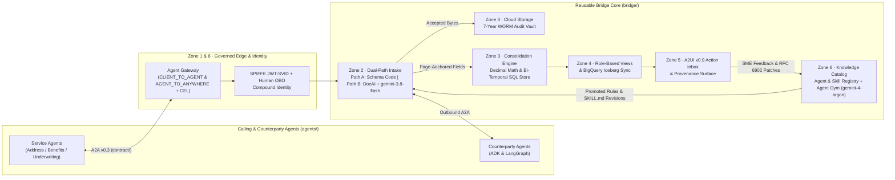

# A2A Document Bridge

Collecting documents from the outside world is slow, messy, and human-paced.
The Bridge **manages that process** so a servicer's agent never touches it — it
asks once and receives documentation already gathered, chased, normalized, and
ready to act on.

It is two things at once: a flagship showcase of the Gemini Enterprise Agent
Platform (Google ADK, A2A, A2UI, Agent Gateway / Identity, OpenTelemetry `gen_ai.*`
observability, and Agent Gym continuous improvement with a multi-model split between
`gemini-3.8-flash` as the runtime workhorse and `gemini-4-argon` as the offline
teacher, judge, and conflict-escalation model) wired into one real system, and a
reusable mediation core that service agents call over canonical A2A.

## Architecture Overview



## The Address demo, in three sentences

A fintech servicer onboards **Jordan Lee** (synthetic — no real PII) and needs
proof of address. The servicer's agent asks the Bridge once: satisfied by **one
government ID, or two utility bills from different companies**. The Bridge
classifies and dispositions each document, chases what's missing, and parks for
human review when confidence is mid; the *agent* — not the Bridge — decides
when the set is complete.

That bounded [Collect](design/collect.md) is [CUJ-10](spec/cujs.md). The same
core also runs the [Benefits](spec/demos/benefits-demo.md) cycle (Negotiate,
Deliver, ADK ↔ LangGraph interop). It also runs the [RFP](spec/demos/rfp-demo.md)
emergent Collect: an RFP board with a consumer `/rfps` read API and manual
chase, a carrier checklist, and email intake, served locally by the RFP demo
host ([docs/local-dev.md](docs/local-dev.md#rfp-demo-host)).

## Who it's for

1. **Teams evaluating the Agent Platform** — Runtime, Skill Registry, Memory
   Bank, Gateway, Identity, A2A and A2UI in one deployed system rather than a
   toy.
2. **Servicers who could adopt it** — a managed mediation service their agent
   calls once.

## Run it locally

Credential-free. Every seam uses its local adapter; extraction is the
deterministic fixture engine over `wiki/evals/`. No GCP, no Gemini, no billing.

**Prerequisites:** Python 3.12+, [uv](https://docs.astral.sh/uv/), Node.js +
[pnpm](https://pnpm.io/).

```bash
uv sync
pnpm install

scripts/run-all.sh          # five Python hosts + four Vite apps; Ctrl-C tears it down
```

The RFP demo is a separate host (:8010); see
[docs/local-dev.md](docs/local-dev.md#rfp-demo-host).
The showcase runner (`scripts/run-showcase.sh`, :8011) boots one core with all three
demos on one Agent Card and one dashboard; see
[docs/local-dev.md](docs/local-dev.md#showcase-runner).

Then open:

| Surface | URL | Who |
|---|---|---|
| Enterprise Showcase Console (`/demo`) | http://localhost:8003/demo | 5-scene interactive walkthrough (Banking, Mortgage & Insurance) |
| Provider portal | http://localhost:5173 | the human party (A2UI) |
| Agent console | http://localhost:5174 | the servicer's agent |
| Ops dashboard | http://localhost:5175 | the operator |
| Time-warp | http://localhost:5176 | presenter control (SLA clock) |
| A2A edge | http://localhost:8000 | Agent Card at `/.well-known/agent-card.json` |

A scriptable Address run (edge already up):

```bash
uv run python -m agents.address \
  --card-url http://localhost:8000/.well-known/agent-card.json
```

Port map, the 8001 mock-vs-portal collision, and CORS:
[docs/local-dev.md](docs/local-dev.md). Env index: [`.env.example`](.env.example).

### Tests & Google Cloud Build CI/CD

```bash
uv run pytest
uv run ruff check
uv run ruff format --check
pnpm --filter @docubridge/shared test
terraform -chdir=terraform test
```

GCP adapter tests are gated on `BRIDGE_TEST_GCP=1`. Continuous integration and container builds run natively on **Google Cloud Build** via [`cloudbuild.yaml`](cloudbuild.yaml); full substrate deployment is [`scripts/deploy.sh`](scripts/deploy.sh) / [`scripts/parity.sh`](scripts/parity.sh) — see [docs/features/gcp-deployment.md](docs/features/gcp-deployment.md).

## Repository map

```
spec/       THE WHAT — requirements (CUJs, standards, demos). Forkable, status-free.
design/     THE HOW — architecture, seams, patterns. Status-free.
TODO.md     live status and sequencing (the only place status lives)
docs/       feature catalog, roadmap, local-dev, upstream ADK issues
wiki/evals/ the eval corpus (Address + Benefits oracles) — a runtime fixture
contract/   shared Pydantic wire types — the ONLY package both bridge/ and agents/ import
bridge/     the reusable core — NEVER imports agents/
agents/     service-agent consumers + demo drivers (Address, Benefits)
skills/     Agent Skills the Bridge loads at runtime
frontend/   four apps (portal, console, dashboard, timewarp) + shared lib + e2e
terraform/  IaC by substrate primitive
tests/      shared seam suite (local + gcp) + golden runs + conformance + perf
scripts/    local run-*.sh hosts + deploy.sh / parity.sh (deployed path)
```

`bridge/` never imports `agents/`. An isolation-guard test enforces this.

## Documentation

| Start here | Why |
|---|---|
| [design/bridge.md](design/bridge.md) | the product, in one page |
| [BANKING.md](BANKING.md) | 5-scene Enterprise Showcase (Banking, Mortgage & Insurance), Agent Gym & Telemetry X-Ray |
| [docs/demo-click-path.md](docs/demo-click-path.md) | 5-minute live demo click-path, Agent Registry & Gateway walkthrough, and Google Slides link |
| [design/agent-gym.md](design/agent-gym.md) | Agent Gym continuous learning, Day-2 payoff & Programmable Trust |
| [design/harness-evolve.md](design/harness-evolve.md) | Agent Gym × Harness Evolve & multi-tier Document AI uptraining |
| [spec/cujs.md](spec/cujs.md) | the journeys the Bridge must support |
| [spec/demos/address-demo.md](spec/demos/address-demo.md) | Address, beat by beat |
| [design/architecture.md](design/architecture.md) | the as-built repo and module map |
| [docs/features.md](docs/features.md) | feature catalog |
| [docs/roadmap.md](docs/roadmap.md) | milestones |
| [TODO.md](TODO.md) | live status |
| [CLAUDE.md](CLAUDE.md) | conventions for coding agents |

A few terms used everywhere:

- **Exchange** — one A2A context: a durable multi-turn interaction about a
  *set* of documents.
- **Sense A / Sense B** — the Bridge judges one document against declared
  rules (A). The calling agent decides whether the set is complete (B).
- **Seam** — a managed-service boundary with a local adapter and a GCP
  adapter; the same tests run against both. Parity is terminal-outcome, not
  ledger-identical.
- **Skill vs eval** — a skill (`skills/`) is how the Bridge behaves; an eval
  (`wiki/evals/`) is how we check it behaved.

The served A2A edge is a deterministic collector (testable without a model).
The `document_bridge` LlmAgent is built but not wired as the front door — see
[design/a2a-edge.md](design/a2a-edge.md).
