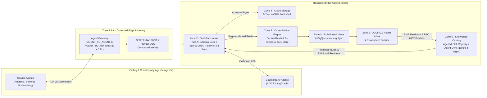

# A2A Document Bridge

Collecting documents across institutions is slow, messy, and human-paced.
**A2A Document Bridge** manages that process end-to-end so a calling service agent
never touches raw document chasing, OCR variance, or cross-document conflicts — it
asks once over canonical Agent-to-Agent (A2A) protocol and receives structured,
page-anchored, audit-locked facts ready to act on.

It serves two purposes in one codebase:
1. **Flagship Google Cloud & Gemini platform Reference Architecture** — a production-grade
   implementation of the 4-Pillar **Gemini platform** (`BUILD`, `GOVERN`, `SCALE`, `OPTIMIZE`)
   combining Google ADK (`google-adk>=2.11.0`), A2A (`a2a-sdk`), A2UI v0.9, Agent Registry &
   Agent Gateway (`CLIENT_TO_AGENT` + `AGENT_TO_ANYWHERE` + IAM v3 CEL), SPIFFE JWT-SVID +
   Human OBO compound identity, OpenTelemetry `gen_ai.*` observability, BigQuery `Rule 0` SQL
   trace evaluation, and **Agent Gym** continuous learning (`gemini-3.8-flash` runtime workhorse
   paired with `gemini-4-argon` as teacher, judge, and conflict-escalation model).
2. **Reusable A2A Mediation Core** — a strictly isolated mediation engine (`bridge/` never
   imports `agents/`) following Hexagonal **Ports & Adapters** (`bridge/ports/`) where all 13
   managed-service boundaries (`sessions`, `task_store`, `exchange_store`, `skill_registry`,
   `memory_bank`, `scheduler`, `a2a_client`, `extraction`, `email_ingress`, `audit_vault`,
   `operational_store`, `action_inbox`, `agent_gym`) are tested against both credential-free
   local adapters and live Google Cloud adapters.


## 4-Pillar Gemini platform Architecture

| Pillar | Capabilities Demonstrated in Document Bridge | Key Modules |
|---|---|---|
| **1. BUILD** | Single-turn & resumable ADK `LlmAgent`s (`google-adk`), `SKILL.md` runtime skill registry, A2A v0.3 JSON-RPC + SSE edge, A2UI v0.9 declarative surfaces, cross-framework ADK ↔ LangGraph interop | `bridge/agent.py`, `bridge/edge/`, `skills/`, `agents/` |
| **2. GOVERN** | Gemini platform **Agent Registry** (`urn:agent`, `urn:mcp`, `urn:endpoint`, `urn:skill` + content-addressed `SkillRevisionRecord`), **Agent Gateway** (`CLIENT_TO_AGENT` Model Armor + Cloud DLP, `AGENT_TO_ANYWHERE` IAM v3 CEL), and **SPIFFE JWT-SVID + Human OBO** least-privilege intersection (`Agent ∩ User`) | `bridge/identity.py`, `bridge/agent_gym/registry_gateway.py`, `bridge/knowledge_catalog.py` |
| **3. SCALE** | **6-Zone Enterprise Data Architecture**: Edge PII redaction, 7-year WORM Cloud Storage Audit Vault (`if_generation_match=0`), deterministic `Decimal` Consolidation Engine, bi-temporal SQL Operational Store (`learned_as_of` × `effective_on`), Role-Based Views, and watermarked BigQuery Open Iceberg sync | `bridge/vault.py`, `bridge/operational_store.py`, `bridge/sql_runtime.py`, `terraform/` |
| **4. OPTIMIZE** | **Agent Gym** continuous learning ("Example of One" SME feedback → 3-Tier evaluation gate → `SKILL.md` compilation → Programmable Trust dial), Two-Sided Oversight (`RSR` anti-rubber-stamping), and **BigQuery `Rule 0` SQL Trace Evaluation** (`v_trace_sql_evaluation` + `AI.GENERATE_TABLE` + Rogan-Gladen debiasing) | `bridge/agent_gym/`, `bridge/telemetry.py`, `terraform/modules/telemetry/` |



## 60-Second Interactive `/demo` Quickstart

Run the 5-scene Enterprise Showcase Console locally with zero cloud credentials required:

```bash
uv sync
uv run uvicorn --factory bridge.dashboard.server:build_dashboard_app --port 8003
```

Open **http://localhost:8003/demo** (or `/console`) to explore all three seeded industry scenarios and cinco interactive scenes:

- **Three Industry Presets (1-Click Header Switcher)**:
  - **Commercial Banking (`LOAN-MERIDIAN-001`)** — Meridian Logistics Center LLC `$45,000,000` CRE Term Loan (`66.18% LTV`, `$68,000,000` appraisal, Page 9 Fee Override Addendum `$225,000.00` vs. `$450,000.00`).
  - **Residential Mortgage (`MORTGAGE-WESTBROOK-2026`)** — Westbrook Family Trust `$1,850,000` 30-Year Jumbo Mortgage (`77.08% LTV`, TRID Closing Disclosure Page 3 Section A rate-lock extension addendum `$8,500.00` vs. `$4,250.00`).
  - **Commercial Specialty Insurance (`terrepower-coastal-2027`)** — Terrepower Coastal LLC `$275,000,000` TIV Property Placement (`$1,650,000.00` total bound premium across 3 carriers).
- **Five Interactive Scenes**:
  1. **Scene 1 · Dual-Path Intake & 7-Year WORM Audit Vault** (`POST /v1/intake/ingest`)
  2. **Scene 2 · Bi-Temporal Operational Store & Role-Based Views** (`GET /v1/a2ui/gemini_app/{entity_id}`, `GET /v1/bigquery/sync`) with click-to-source PDF polygon proof modal
  3. **Scene 3 · 6-Hop Lineage, SPIFFE Zero-Trust & 6-Tab Agent Registry / Gateway Explorer** (`GET /v1/registry/catalog`, `POST /v1/gateway/evaluate-route`)
  4. **Scene 4 · Agent Gym Continuous Learning & Day-2 Payoff** (`POST /v1/gym/signals/from-quarantine`, `POST /v1/gym/rules/{rule_id}/evaluate`, `POST /v1/gym/compile-skill`)
  5. **Scene 5 · OpenTelemetry `gen_ai.*` Waterfall & BigQuery `Rule 0` SQL Trace Evaluation** (`GET /v1/telemetry/analytics`, `POST /v1/telemetry/sql-eval/run`)

Full walkthrough script: [BANKING.md](BANKING.md) and [docs/demo-click-path.md](docs/demo-click-path.md).

## The A2A Protocol & Multi-Agent Service Demos

Behind the enterprise console, the reusable Bridge core mediates four canonical A2A patterns:

1. **Address Verification (`CUJ-1`, `CUJ-4`, `CUJ-10` — Bounded Collect)**:
   A fintech servicer onboards **Jordan Lee** (synthetic — no real PII) and needs proof of
   address: **one government ID, or two utility bills from different companies**. The Bridge
   classifies and dispositions each document (`run_disposition_gate`), chases what is missing,
   and parks for human review when confidence is mid; the *calling agent* — not the Bridge —
   decides when the set is satisfied.
2. **Employee Benefits Procurement (`CUJ-3`, `CUJ-11`, `CUJ-12` — Fan-Out Negotiate & ADK ↔ LangGraph Interop)**:
   Fans out a program (`program:acme-2026`) across four carriers (ADK A2A, LangGraph A2A,
   French/EUR PDF, German/GBP PDF), normalizes currency and language, flags coverage gaps
   against `standard.yaml`, negotiates a versioned revision over A2A with the LangGraph
   carrier, and binds the program rollup.
3. **Emergent RFP Collection (`CUJ-9`, `CUJ-13` — Shared Board & Email Ingress)**:
   Opens multi-carrier RFP matrices (`acme-vb-2027`) over A2A, correlates inbound M365/MIME
   carrier emails by HMAC token (`bridge/email_ingress/`), and hot-reloads newly uploaded
   process + doctype skills into a running core with zero restart.
4. **Hybrid A2A Edge (`BRIDGE_EDGE_MODE=deterministic|hybrid`)**:
   Routes structured `CollectRequest` and Path-A assertions through the deterministic
   zero-LLM Collector while routing off-script intents (deletion, escalation) and
   `bridge-hitl: park` pauses through the resumable `document_bridge` `LlmAgent` with pinned
   disposition gate inputs (`bridge/gatepin.py`).

## Run All Local Surfaces

Credential-free. Every seam uses its local adapter; extraction uses the deterministic
fixture engine over `wiki/evals/`. No GCP, no Gemini API key, and no billing required.

**Prerequisites:** Python 3.12+, [uv](https://docs.astral.sh/uv/), Node.js + [pnpm](https://pnpm.io/).

```bash
uv sync
pnpm install

scripts/run-all.sh          # five Python hosts + four Vite apps; Ctrl-C tears it down
```

The RFP demo is a separate host (`:8010`); see [docs/local-dev.md](docs/local-dev.md#rfp-demo-host).
The unified showcase runner (`scripts/run-showcase.sh`, `:8011`) boots one core with all three
A2A demos on one Agent Card and one dashboard; see [docs/local-dev.md](docs/local-dev.md#showcase-runner).

| Surface | URL | Role |
|---|---|---|
| Enterprise Showcase Console (`/demo`) | http://localhost:8003/demo | 5-scene interactive walkthrough (Banking, Mortgage & Insurance) |
| Provider portal | http://localhost:5173 | External party upload & A2UI Path-B host |
| Agent console | http://localhost:5174 | Calling service agent session & turn viewer |
| Ops dashboard | http://localhost:5175 | Operator read-model, HITL/escalation queues & RFP board |
| Time-warp | http://localhost:5176 | Virtual SLA clock control (`overdue → reminder → escalated`) |
| A2A edge | http://localhost:8000 | Agent Card at `/.well-known/agent-card.json` |

A scriptable Address run (with the A2A edge up):

```bash
uv run python -m agents.address \
  --card-url http://localhost:8000/.well-known/agent-card.json
```

Port map and environment variable index: [docs/local-dev.md](docs/local-dev.md) and [`.env.example`](.env.example).

## Tests, Static Analysis & Google Cloud Build CI/CD

```bash
uv run pytest
uv run ruff check
uv run ruff format --check
pnpm --filter "!@docubridge/e2e" -r test
terraform -chdir=terraform test
```

- **100% Static Type & Docstring Enforcement:** `ruff check` enforces `ANN001`, `ANN201`, and `ANN202` across all `bridge/`, `contract/`, and `agents/` modules alongside `>=85%` test coverage.
- **Google Cloud Build CI/CD:** Continuous integration and container builds run natively on **Google Cloud Build** via [`cloudbuild.yaml`](cloudbuild.yaml) (a 4-track parallel DAG running Python lint + sharded `pytest -n 4` + `>=85%` coverage gate, all 5 frontend workspaces, `terraform test`, and BuildKit image caching before pushing to Artifact Registry). Full substrate deployment is [`scripts/deploy.sh`](scripts/deploy.sh) / [`scripts/parity.sh`](scripts/parity.sh) — see [docs/features/gcp-deployment.md](docs/features/gcp-deployment.md).

## Repository Map

```
spec/       THE WHAT — requirements (CUJs, standards, demos). Forkable, status-free, protected.
design/     THE HOW — architecture, seams, zones, patterns, agent-gym, harness-evolve. Status-free.
TODO.md     live status and sequencing (the only place status lives)
DECISIONS.md architectural decision records (ADR-01 through ADR-12) & milestone history
BANKING.md  5-scene Enterprise Showcase architecture & walkthrough (Banking, Mortgage, Insurance)
docs/       feature catalog, demo click-path, roadmap, local-dev, upstream ADK issues
wiki/evals/ the eval corpus (Address + Benefits oracles) — a runtime fixture
contract/   shared Pydantic wire types — the ONLY package both bridge/ and agents/ import
bridge/     the reusable core — NEVER imports agents/
agents/     service-agent consumers + demo drivers (Address, Benefits ADK & LangGraph carriers)
skills/     Agent Skills the Bridge loads at runtime
demo/       5-scene Enterprise Showcase Console (enterprise-demo.{html,css,js})
frontend/   four React/Vite apps (portal, console, dashboard, timewarp) + shared lib + e2e
terraform/  IaC by substrate primitive (network, iam, database, secrets, gcs, tasks, telemetry, runtime, gateway, frontend)
tests/      shared seam suite (local + gcp) + enterprise architecture + golden runs + conformance + perf
scripts/    local run-*.sh hosts + deploy.sh / parity.sh (deployed path)
```

`bridge/` never imports `agents/`, and `agents/` never imports `bridge/`. AST isolation-guard tests (`tests/test_isolation_guard.py`) enforce both directions.

## Documentation Index

| Start here | Why |
|---|---|
| [BANKING.md](BANKING.md) | 5-scene Enterprise Showcase (Banking, Mortgage & Insurance), 6-Zone Data Architecture, Agent Gym & BigQuery SQL Eval |
| [docs/demo-click-path.md](docs/demo-click-path.md) | 5-minute live demo click-path, Agent Registry & Gateway walkthrough, and BigQuery SQL evaluation guide |
| [DECISIONS.md](DECISIONS.md) | Executive Architecture Decision Records (ADR-01 through ADR-12) |
| [design/bridge.md](design/bridge.md) | The mediation product in one page |
| [design/agent-gym.md](design/agent-gym.md) | Agent Gym continuous learning, Day-2 payoff, Two-Sided Oversight (`RSR`) & Programmable Trust |
| [design/harness-evolve.md](design/harness-evolve.md) | Agent Gym × Harness Evolve (`SKILL.md` compilation) & multi-tier Document AI uptraining |
| [design/seams.md](design/seams.md) | Hexagonal Ports & Adapters (`bridge/ports/` & `bridge/seams/`) across all 13 managed-service boundaries |
| [spec/cujs.md](spec/cujs.md) | Critical User Journeys (`CUJ-1` through `CUJ-13`) |
| [design/architecture.md](design/architecture.md) | As-built repository and module map |
| [docs/features.md](docs/features.md) | Feature catalog across all phases and sprints |
| [CLAUDE.md](CLAUDE.md) | Engineering conventions and operational lessons learned |

## Core Glossary

- **Exchange** — one A2A context: a durable multi-turn interaction about a *set* of documents.
- **Sense A / Sense B** — the Bridge judges one document against declared rules (A). The calling agent decides whether the set is complete or which quote to bind (B).
- **Port & Adapter (Seam)** — a managed-service boundary (`bridge/ports/`) with a local adapter and a GCP adapter; the same `@pytest.mark.port` / `@pytest.mark.seam` tests run against both (`BRIDGE_PORT_MODE=local|gcp`). Parity is terminal-outcome, not ledger-identical.
- **Skill vs eval** — a skill (`skills/`) is how the Bridge behaves; an eval (`wiki/evals/`) is how we verify it behaved.

