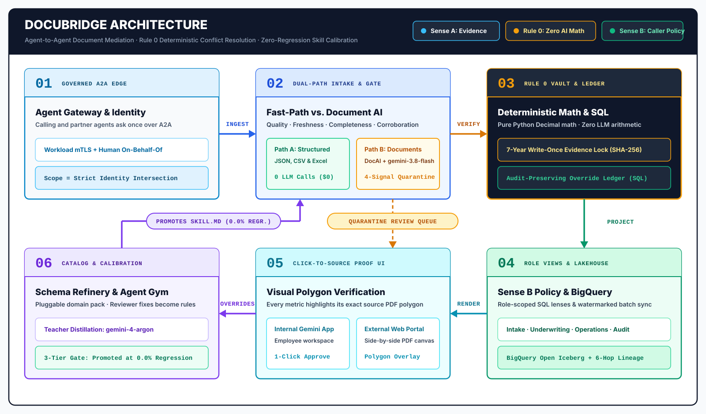

# DocuBridge: Stop Letting Prompts Reconcile Documents

I built DocuBridge because multi-document workflows break the moment an LLM guesses which version wins. Late one-page addenda tie with base contracts, summary math drifts on dollars, and tired reviewers rubber-stamp bad scans. DocuBridge keeps intake, page-pinned fields, and code-only overrides behind one service boundary so calling agents don't touch raw paperwork.



## Why Not Default IDP or Prompt Tools?

For single clean forms, a managed extractor (Document AI, Textract, Azure Doc Intelligence) plus a SQL table is simpler. If one ops team owns the workflow, ABBYY Vantage or UiPath Document Understanding already ships review queues and audit logs.

The gap opens when **many agents** share changing packets (contracts, IDs, vendor quotes, filings):

| Default approach | What it handles well | Where it breaks for many agents |
| :--- | :--- | :--- |
| **Managed OCR + Postgres + REST/MCP** (Document AI, Textract, Azure Doc Intelligence) | Strong extraction, pinned versions | No conflict resolver or review queue; thin REST/MCP wrappers lack A2A v1.0 pauses (`INPUT_REQUIRED`) and typed `contract/` policy split |
| **Enterprise IDP suite** (ABBYY Vantage, UiPath Document Understanding) | Turnkey review, tenant audit logs | Couples intake, review, and rules in one suite; callers cannot split facts from policy over an open API |
| **Per-agent LLM prompts** | Fast prototypes | Guesses which addendum wins, drifts on decimals, and can approve bad scans without code gates |

DocuBridge checks document integrity (legible scan, type, fields); callers pass policy (freshness, risk thresholds, waivers, completion). Core runs on Python, PostgreSQL 16 (SQLite locally), and A2A v1.0 across `14` adapters, with pluggable catalogs (identity, benefits, lending, mortgage, insurance) and a Google Cloud adapter.

## What the Code Guarantees

`1,936 / 1,991` Python tests pass offline (`55` cloud-adapter tests skipped without credentials; `14/14` local adapters; `0` live noisy-PDF runs measured here).

| Guarantee | Code check | Verified offline receipt (synthetic) |
| :--- | :--- | :--- |
| **Chase missing files; reject bad scans; `$0` JSON** | JSON skips the model; scans pass legibility, type, confidence, and caller freshness checks before WORM vault lock; missing items trigger follow-ups. Models cannot self-approve. | `133/133` gate checks over `8` synthetic docs + `3` adversaries ([test_edge_gate_inversion.py](tests/test_edge_gate_inversion.py)); `27/27` collect + `10/10` follow-up ([test_collect.py](tests/test_collect.py), [test_followup.py](tests/test_followup.py)) |
| **Code-only overrides & WORM vault** | Declared precedence resolves late addenda by arrival and effective date in `Decimal` math; append-only ledger and write-once vault reject silent overwrites. | `29/29` enterprise architecture checks across `3` conflict scenarios + vault tamper refusal, `0` float drift ([test_enterprise_data_architecture.py](tests/test_enterprise_data_architecture.py)) |
| **Zero-regression gate on rule updates** | Edits need a page citation and dwell time before updating hints; promotions fail closed on regressions and reject hardcoded test data. | `8/8` zero-regression checks ([test_schema_refinery_engine.py](tests/test_schema_refinery_engine.py)); `8/8` calibration honesty & fail-closed oversight guards ([test_calibration_honesty.py](tests/test_calibration_honesty.py)) |
| **Caller policy stays outside** | Callers use A2A v1.0 + `contract/` types only; AST guards forbid consumer imports or hardcoded skill names. | `6/6` A2A consumer ([test_a2a_consumer_contract.py](tests/test_a2a_consumer_contract.py)); `12/12` isolation ([test_isolation_guard.py](tests/test_isolation_guard.py)) |

## Where This Breaks

1. **Synthetic fixtures only (`N = 0` live noisy-PDF runs):** Offline checks replay `15` synthetic records (`wiki/evals/`) and `5` seeded scenarios; no open-loop benchmark on degraded scans or prompt-vs-code error rates exists yet.
2. **Upfront catalog rules:** Code never guesses priority for unseen types. Declare schemas and overrides in `catalog/doctypes/`; unknown files park for review.
3. **Cold-start review tax & OCR errors:** High-risk slices need `5` verified human matches before auto-approval unlocks. If OCR misreads a digit and a reviewer approves it, `Decimal` code compounds the error.
4. **Local SQLite & dev auth:** Local mode shares one SQLite file across `5` stores, hashes in memory, and uses dev auth. Production needs PostgreSQL 16+, object-lock storage, and mTLS/IAM via `14` adapters (Google Cloud ships in-repo; AWS/Azure/on-prem need adapters).

## Quick Start

Run A2A consumer, prompt-adversary, and version-override checks offline (`0` credentials, `168` checks):

```bash
uv sync && uv run pytest tests/test_a2a_consumer_contract.py tests/test_edge_gate_inversion.py tests/test_enterprise_data_architecture.py -q
```

Browser demo (`:8003`): [docs/demo-click-path.md](docs/demo-click-path.md). External A2A caller (`examples/a2a_consumer/consume_bridge.py`): [docs/consume-over-a2a.md](docs/consume-over-a2a.md).

## Deep Dives

[Architecture, 10-line A2A client & SQL trace eval](docs/architecture-overview.md) · [A2A contract](docs/consume-over-a2a.md) · [Reference vertical walkthroughs](BANKING.md) · [Design tree](design/bridge.md) · [Decisions](DECISIONS.md) · [Roadmap](docs/roadmap.md) · [Contributing](CONTRIBUTING.md)
