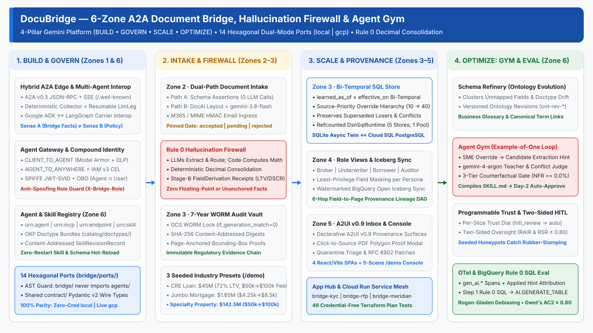

# DocuBridge: Evidence-First A2A Document Mediation & Conflict Resolution



When an underwriting or onboarding agent ingests a multi-document packet directly inside an LLM prompt, three production failure modes break automation: late 1-page addenda tie with base contracts (for example, a Schedule B Page 4 Fee Addendum doubling a `$45,000,000` commercial real estate loan's `origination_fee` from `$50,000.00` to `$100,000.00`), probabilistic token summaries silently corrupt financial arithmetic, and fatigued human operators rubber-stamp bad OCR spans on Day 2. Calling service agents should never chase external counterparties, reconcile OCR conflicts, or compute balances inside a prompt.

**DocuBridge** isolates multi-party document collection and conflict resolution behind a canonical Agent-to-Agent (A2A) endpoint across 14 hexagonal ports (`local` zero-credential replay and `gcp` managed services) by enforcing an **Evidence Left, Judgment Right** boundary:
1. **Sense A (Deterministic Intake & Rule 0 Consolidation):** Structured JSON, CSV, and Excel feeds validate at `$0` LLM cost (**Path A**). Unstructured PDFs (**Path B**: Document AI plus `gemini-3.8-flash`) are anchored to source PDF polygons and screened by a deterministic **4-Signal Quarantine Gate** (`quality`, `freshness`, `completeness`, `corroboration`) where a model can never self-approve compliance. Under **Rule 0: Zero AI Math**, accepted bytes lock in a 7-year SHA-256 WORM vault and cross-document overrides reconcile in pure Python `Decimal` SQL (tracking both when a document arrived and when its terms take effect so late addenda override base disclosures without erasing prior audit state).
2. **Sense B (Caller-Owned Policy & Zero-Regression Calibration):** The calling service agent retains sole authority over packet completeness, LTV limits, and requirement waivers. When human reviewers patch quarantined edge cases in the side-by-side PDF polygon UI, **Two-Sided Oversight** verifies reviewer scrutiny (`RSR >= 0.80` from polygon citation check and review dwell time) before `gemini-4-argon` compiles versioned `SKILL.md` and ontology rules that promote only at `0.0%` false-accept regression (`FA = 0`, `NFR = 0.0%`), backed by 3-layer BigQuery SQL trace evaluation (`100%` OpenTelemetry trace coverage at `$0` LLM cost, `~95%` judge token reduction, and Rogan-Gladen prevalence debiasing).

## Why Default IDP + LLM Tool Calls Fail vs. DocuBridge Guarantees

| Production Failure Mode | Naive LLM / Default IDP Baseline | DocuBridge Deterministic & Statistical Mechanism | Enforced Invariant & Seeded Proof |
| :--- | :--- | :--- | :--- |
| **Structured Feed Token Waste & Compliance Self-Approval** | Routes clean JSON/CSV feeds through prompts; asks an LLM whether an expired or blurry document is acceptable | **Dual-Path Intake & 4-Signal Quarantine Gate (`ADR-02`, `ADR-05`):** Path A validates structured feeds via JSON Schema; Path B (`DocAI` + `gemini-3.8-flash`) evaluates **Quality** (`>= quality_threshold`), **Freshness** (`<= max_age_days`), **Completeness** (required fields + PDF polygon `SourceAnchor`), and **Corroboration** | **`0` LLM calls (`$0`)** on Path A; **`0%` model self-approval** (`test_edge_gate_inversion.py` blocks models from minting `accepted`); accepted bytes lock into a **7-year SHA-256 WORM Vault** |
| **Late Addendum Priority Ties & Float Arithmetic Drift** | Monolithic schema ties (`Prio 20 == Prio 20`, Jaccard sparsity $J(A,B) \le 0.10$) and LLM token math silently drop 1-page addenda | **Rule 0 `Decimal` Conflict Consolidation (`ADR-06`, `ADR-13`):** Pure Python `Decimal` math (zero LLM arithmetic) resolves typed ontology `[:SUPERSEDES]` precedence across arrival time (`recorded_at`) and effective date (`effective_from`) | Resolves **`$50,000.00` to `$100,000.00`** CRE Schedule B Page 4 fee override (`$45,000,000` loan, `72.00% LTV`), **`$4,250.00` to `$8,500.00`** TRID mortgage lock (`$1,850,000`, `77.08% LTV`), and **`$50,000.00` to `$100,000.00`** wind/hail deductible (`$142,500,000` TIV, `$418,500.00` premium) with **`0` float drift** |
| **Reviewer Rubber-Stamping & Prompt-Edit Regression** | Unverified human clicks poison few-shot prompts; fixing one carrier layout breaks others | **Two-Sided Oversight & 3-Tier Calibration Gate (`ADR-10`, `ADR-13`, `ADR-15`):** Requires **Reviewer Scrutiny Score `RSR >= 0.80`** (PDF bounding-box citation check + dwell time) before `gemini-4-argon` distills rules across **Tier 1** (`Rule 0` `Decimal` firewall), **Tier 2** (`gemini-4-argon` counterfactual assay), and **Tier 3** (`threshold_corridor()`) | Promotes `SKILL.md` and ontology splits only at **False Accepts `FA = 0`**, **Negative Flip Rate `NFR = 0.0%`**, and live-extractor perturbation stability **Krippendorff's $\alpha \ge 0.80$** and **Gwet's $\text{AC}_2 \ge 0.80$** |
| **100% LLM-as-a-Judge Cost & Autorater Bias** | Running a frontier judge on 100% of traces is cost-prohibitive and skewed by imperfect judge sensitivity/specificity ($q_1, q_0 < 1$) | **3-Layer BigQuery `Rule 0` SQL Trace Eval (`ADR-12`):** **Layer 1** checks 5 deterministic `Rule 0` SQL gates across 100% of OTel `gen_ai.*` traces; **Layer 2** invokes `AI.GENERATE_TABLE` (`gemini-4-argon`) only on anomalies; **Layer 3** applies **Rogan-Gladen debiasing** $\hat{\theta} = \text{clip}\!\left(\frac{p_{\text{obs}} + q_0 - 1}{q_1 + q_0 - 1}, 0, 1\right)$ | **`100%` trace governance at `$0` SQL token cost**, cutting `gemini-4-argon` judge token spend by **`~95%`** (`~5%` anomaly sampling) |

## 60-Second Interactive `/demo` Quickstart

Run the 5-scene Enterprise Showcase Console locally with zero cloud credentials required:

```bash
uv sync
uv run uvicorn --factory bridge.dashboard.server:build_dashboard_app --port 8003
```

Open **http://localhost:8003/demo** (or `/console`) to explore all three seeded industry scenarios and five interactive scenes:

- **Three Industry Presets (1-Click Header Switcher)**:
  - **Commercial Banking (`LOAN-MERIDIAN-001`)**: Meridian Logistics Center LLC `$45,000,000` CRE Term Loan (`72.00% LTV`, `$62,500,000` appraisal, Schedule B Page 4 Fee Addendum overriding `origination_fee` from `$50,000.00` to `$100,000.00`).
  - **Residential Mortgage (`MORTGAGE-WESTBROOK-2026`)**: Westbrook Family Trust `$1,850,000` 30-Year Jumbo Mortgage (`77.08% LTV`, `$2,400,000` appraisal, TRID Closing Disclosure Page 3 Section A rate-lock extension addendum overriding `origination_fee` from `$4,250.00` to `$8,500.00`).
  - **Commercial Specialty Insurance (`terrepower-coastal-2027`)**: Terrepower Coastal LLC `$142,500,000` TIV Property Placement (`$50,000,000` coverage limit, `$418,500.00` annual premium, Page 4 Wind/Hail Deductible Endorsement overriding `deductible` from `$50,000.00` to `$100,000.00`).
- **Five Interactive Scenes**:
  1. **Scene 1 · Dual-Path Intake & 7-Year WORM Audit Vault** (`POST /v1/intake/ingest`)
  2. **Scene 2 · Operational Store & Role-Based Views** (`GET /v1/a2ui/gemini_app/{entity_id}`, `GET /v1/bigquery/sync`) with click-to-source PDF polygon proof modal
  3. **Scene 3 · 6-Hop Lineage, SPIFFE Zero-Trust & 6-Tab Agent Registry / Gateway Explorer** (`GET /v1/registry/catalog`, `POST /v1/gateway/evaluate-route`)
  4. **Scene 4 · Calibration (Agent Gym) & Day-2 Payoff** (`POST /v1/gym/signals/from-quarantine`, `POST /v1/gym/rules/{rule_id}/evaluate`, `POST /v1/gym/compile-skill`)
  5. **Scene 5 · OpenTelemetry `gen_ai.*` Waterfall & BigQuery `Rule 0` SQL Trace Evaluation** (`GET /v1/telemetry/analytics`, `POST /v1/telemetry/sql-eval/run`)

Full walkthrough script: [BANKING.md](BANKING.md) and [docs/demo-click-path.md](docs/demo-click-path.md).

## Consume Over A2A in 10 Lines (Day-1 Progressive Adoption)

Downstream teams do not fork this repository. A calling service agent discovers DocuBridge at `/.well-known/agent-card.json`, sends one `CollectRequest` over A2A JSON-RPC, and receives page-anchored, `Decimal`-consolidated facts back:

```python
import httpx
from contract.wire import CONTRACT_VERSION, CollectRequest

req = CollectRequest(
    process="commercial-loan-underwriting",
    party="LOAN-MERIDIAN-001",
    context_id="ctx-meridian-001",
)
resp = httpx.post(
    "http://localhost:8000/",
    headers={"A2A-Version": "1.0"},
    json={
        "jsonrpc": "2.0",
        "id": "req-1",
        "method": "SendMessage",
        "params": {
            "message": {
                "messageId": "m-1",
                "role": "ROLE_USER",
                "parts": [
                    {
                        "data": req.model_dump(mode="json"),
                        "metadata": {
                            "kind": "collect_request",
                            "contract_version": CONTRACT_VERSION,
                        },
                    }
                ],
            }
        },
    },
).json()
print(resp["result"]["task"]["status"]["state"], resp["result"]["task"]["artifacts"])
```

What a downstream team brings is a doctype or process skill folder under `skills/` (`SKILL.md` plus `assets/`), an ontology doctype bundle under `catalog/doctypes/` (entity scope, contrastive field descriptions, and `[:SUPERSEDES]` precedence edges), and a scenario the Bridge mediates. The Bridge core hot-loads the skills and resolves the bundle through the Zone 6 Knowledge Catalog without code changes. See [CONTRIBUTING.md](CONTRIBUTING.md) and [docs/consume-over-a2a.md](docs/consume-over-a2a.md).

## Multi-Agent A2A Service Patterns & 4-Pillar Architecture

Behind the enterprise console, the reusable Bridge core mediates four canonical A2A patterns:

1. **Address Verification (Bounded Collect)**:
   A fintech servicer onboards **Jordan Lee** (synthetic, no real PII) and requires **one government ID, or two utility bills from different companies**. DocuBridge classifies and dispositions each document (`run_disposition_gate`), chases what is missing, and parks mid-confidence scans for human review; the calling agent, not the Bridge, decides when the set is satisfied.
2. **Employee Benefits Procurement (Fan-Out Negotiate & ADK / LangGraph Interop)**:
   Fans out a program (`program:acme-2026`) across four carriers (ADK A2A, LangGraph A2A, French/EUR PDF, German/GBP PDF), normalizes currency and language, flags coverage gaps against `standard.yaml`, negotiates a versioned revision over A2A with the LangGraph carrier, and binds the program rollup.
3. **Emergent RFP Collection (Shared Board & Email Ingress)**:
   Opens multi-carrier RFP matrices (`acme-vb-2027`) over A2A, correlates inbound M365/MIME carrier emails by HMAC token (`bridge/email_ingress/`), and hot-reloads newly uploaded process and doctype skills into a running core with zero restart.
4. **Hybrid A2A Edge (`BRIDGE_EDGE_MODE=deterministic|hybrid`)**:
   Routes structured `CollectRequest` and Path-A assertions through the deterministic zero-LLM Collector while routing off-script intents (deletion, escalation) and `bridge-hitl: park` pauses through the resumable `document_bridge` `LlmAgent` with pinned disposition gate inputs (`bridge/gatepin.py`).

| Gemini platform Pillar | Capabilities Demonstrated in DocuBridge | Key Modules |
| :--- | :--- | :--- |
| **1. BUILD** | Single-turn and resumable ADK `LlmAgent`s (`google-adk`), `SKILL.md` runtime skill registry, A2A JSON-RPC + SSE edge, A2UI v0.9 declarative surfaces, cross-framework ADK and LangGraph interop | `bridge/agent.py`, `bridge/edge/`, `skills/`, `agents/` |
| **2. GOVERN** | Gemini platform **Agent Registry** (`urn:agent`, `urn:mcp`, `urn:endpoint`, `urn:skill` + content-addressed `SkillRevisionRecord`), **Agent Gateway** (`CLIENT_TO_AGENT` Model Armor + Cloud DLP, `AGENT_TO_ANYWHERE` IAM v3 CEL), and **SPIFFE JWT-SVID + Human OBO** least-privilege intersection (`Agent ∩ User`) | `bridge/identity.py`, `bridge/agent_gym/registry_gateway.py`, `bridge/knowledge_catalog/` |
| **3. SCALE** | **6-Zone Enterprise Data Architecture**: Edge PII redaction, 7-year WORM Cloud Storage Audit Vault (`if_generation_match=0`), deterministic `Decimal` Consolidation Engine, audit-preserving SQL Operational Store (`recorded_at` by `effective_from`), Role-Based Views, and watermarked BigQuery Open Iceberg sync | `bridge/vault.py`, `bridge/operational_store/`, `bridge/sql_runtime.py`, `terraform/` |
| **4. OPTIMIZE** | **Calibration**: Schema Refinery evolves the ontology and Agent Gym evolves the skills (SME feedback, 3-Tier evaluation gate, `SKILL.md` compilation, Programmable Trust dial), Two-Sided Oversight (`RSR >= 0.80` anti-rubber-stamping), and **BigQuery `Rule 0` SQL Trace Evaluation** (`v_step1_trace_eval` / `v_trace_sql_evaluation` + `AI.GENERATE_TABLE` + Rogan-Gladen debiasing) | `bridge/agent_gym/`, `bridge/telemetry/`, `terraform/modules/telemetry/` |

## Run All Local Surfaces

Credential-free. Every port across all 14 hexagonal boundaries (`sessions`, `task_store`, `exchange_store`, `skill_registry`, `memory_bank`, `scheduler`, `a2a_client`, `extraction`, `email_ingress`, `audit_vault`, `operational_store`, `action_inbox`, `agent_gym`, `knowledge_catalog`) uses its local adapter; extraction uses the deterministic fixture engine over `wiki/evals/`. No GCP, no Gemini API key, and no billing required.

**Prerequisites:** Python 3.12+, [uv](https://docs.astral.sh/uv/), Node.js + [pnpm](https://pnpm.io/).

```bash
uv sync
pnpm install

scripts/run-all.sh          # five Python hosts + four Vite apps; Ctrl-C tears it down
```

The RFP demo is a separate host (`:8010`); see [docs/local-dev.md](docs/local-dev.md#rfp-demo-host).
The unified showcase runner (`scripts/run-showcase.sh`, `:8011`) boots one core with all three A2A demos on one Agent Card and one dashboard; see [docs/local-dev.md](docs/local-dev.md#showcase-runner).

| Surface | URL | Role |
| :--- | :--- | :--- |
| Enterprise Showcase Console (`/demo`) | http://localhost:8003/demo | 5-scene interactive walkthrough (Banking, Mortgage & Insurance) |
| Provider portal | http://localhost:5173 | External party upload & A2UI Path-B host |
| Agent console | http://localhost:5174 | Calling service agent session & turn viewer |
| Ops dashboard | http://localhost:5175 | Operator read-model, HITL/escalation queues & RFP board |
| Time-warp | http://localhost:5176 | Virtual SLA clock control (`overdue`, `reminder`, `escalated`) |
| A2A edge | http://localhost:8000 | Agent Card at `/.well-known/agent-card.json` |

A scriptable Address run (with the A2A edge up):

```bash
uv run python -m agents.address \
  --card-url http://localhost:8000/.well-known/agent-card.json
```

Port map and environment variable index: [docs/local-dev.md](docs/local-dev.md) and [`.env.example`](.env.example).

## Tests, Static Analysis & Google Cloud Build CI/CD

```bash
uv run pytest
uv run ruff check
uv run ruff format --check
pnpm --filter "!@docubridge/e2e" -r test
terraform -chdir=terraform init -backend=false && terraform -chdir=terraform test
```

- **100% Static Type & Docstring Enforcement:** `ruff check` enforces `ANN001`, `ANN201`, and `ANN202` across all `bridge/`, `contract/`, and `agents/` modules alongside `>=90%` test coverage.
- **Google Cloud Build CI/CD:** Continuous integration and container builds run natively on **Google Cloud Build** via [`cloudbuild.yaml`](cloudbuild.yaml) (a 4-track parallel DAG running Python lint + sharded `pytest -n 4` + `>=90%` coverage gate, all 5 frontend workspaces, `terraform test`, and BuildKit image caching before pushing to Artifact Registry). Full substrate deployment is [`scripts/deploy.sh`](scripts/deploy.sh) / [`scripts/parity.sh`](scripts/parity.sh); see [docs/features/gcp-deployment.md](docs/features/gcp-deployment.md).

## Where This Breaks / Known Limitations

1. **Offline Fixture Replay vs. Live Optical Perturbation (`Level 2` vs. `Level 3`):** In zero-credential local mode (`BRIDGE_PORT_MODE=local`), extraction replays deterministic oracle fixtures (`wiki/evals/`) and `evaluate_ontology_proposal()` honestly reports `perturbation_evaluated=False` unless a live extractor (`BRIDGE_PORT_EXTRACTION=gcp`) is injected.
2. **Declarative Formula & Precedence Prerequisite (`Rule 0`):** Because `Rule 0` forbids LLM arithmetic and ad-hoc precedence guessing, any new financial rollup or document subtype override must be declared in `catalog/doctypes/*.okf.md` (`[:SUPERSEDES]` / `[:FEEDS_METRIC]`) or promoted through the Schema Refinery before Zone 3 consolidates it.
3. **`HIGH`-Risk Autonomy Promotion Cannot Be Force-Bypassed:** Slices marked `risk_level="HIGH"` require all `5/5` consecutive human-verified shadow matches (`citation_verified=True` and `RSR >= 0.80`) before promoting to `trusted_auto_approve`; `force=True` overrides are rejected on `HIGH`-risk slices.
4. **Local Single-Node SQLite vs. Multi-Replica Cloud SQL:** Local runs multiplex all 5 SQL stores over a single-process SQLite `DsnSqlRuntime`; multi-replica horizontal scaling requires `BRIDGE_PORT_MODE=gcp` with Cloud SQL for PostgreSQL 16 / AlloyDB (`DATABASE_URL` + optional `BRIDGE_DB_IAM_AUTH=1`).

## Repository Map

```text
spec/       THE WHAT: requirements (CUJs, standards, demos). Forkable, status-free, protected.
design/     THE HOW: architecture, ports, zones, patterns, agent-gym, harness-evolve. Status-free.
DECISIONS.md architectural decision records (ADR-01 through ADR-15) & milestone history
BANKING.md  5-scene Enterprise Showcase architecture & walkthrough (Banking, Mortgage, Insurance)
docs/       feature catalog, demo click-path, roadmap (the only place status lives), local-dev, upstream ADK issues
wiki/evals/ the eval corpus (Address + Benefits oracles), a runtime fixture
contract/   shared Pydantic wire types, the ONLY package both bridge/ and agents/ import
bridge/     the reusable core (NEVER imports agents/)
agents/     service-agent consumers + demo drivers (Address, Benefits ADK & LangGraph carriers)
skills/     Agent Skills the Bridge loads at runtime
demo/       5-scene Enterprise Showcase Console (enterprise-demo.{html,css,js})
frontend/   four React/Vite apps (portal, console, dashboard, timewarp) + shared lib + e2e
terraform/  IaC by substrate primitive (network, iam, database, secrets, gcs, tasks, telemetry, runtime, gateway, frontend)
tests/      shared port suite (local + gcp) + enterprise architecture + golden runs + conformance + perf
scripts/    local run-*.sh hosts + deploy.sh / parity.sh (deployed path)
```

`bridge/` never imports `agents/`, and `agents/` never imports `bridge/`. Declarative AST isolation-guard rules (`specs/ast.rules.yaml` and `tests/test_isolation_guard.py`) enforce both directions.

## Documentation Index

| Start here | Why |
| :--- | :--- |
| [BANKING.md](BANKING.md) | 5-scene Enterprise Showcase (Banking, Mortgage & Insurance), 6-Zone Data Architecture, Agent Gym & BigQuery SQL Eval |
| [docs/demo-click-path.md](docs/demo-click-path.md) | 5-minute live demo click-path, Agent Registry & Gateway walkthrough, and BigQuery SQL evaluation guide |
| [DECISIONS.md](DECISIONS.md) | Executive Architecture Decision Records (`ADR-01` through `ADR-15`) |
| [design/bridge.md](design/bridge.md) | The mediation product in one page, the root of the design tree |
| [design/model.md](design/model.md) | What the Bridge is: exchange / task / session / party, the closed pattern set, disposition, artifacts, outbound |
| [design/edges.md](design/edges.md) | How you talk to it: the A2A edge and consumer, the service-agent shape, the human edge, email intake, RFP views |
| [design/knowledge-model.md](design/knowledge-model.md) | What things are (ontology) vs. how we collect them (skills) vs. how it learns (Schema Refinery, Agent Gym, Harness Evolve) |
| [design/runtime.md](design/runtime.md) | How it runs: ADK, the 14 managed-service ports, the two-zone trust boundary, proactive follow-up, deploying the resumable loop |
| [spec/cujs.md](spec/cujs.md) | Critical User Journeys (`CUJ-1` through `CUJ-15`) |
| [design/architecture.md](design/architecture.md) | As-built repository and module map |
| [docs/features.md](docs/features.md) | Feature catalog across all phases and sprints |
| [CLAUDE.md](CLAUDE.md) | Engineering conventions and operational lessons learned |
| [CONTRIBUTING.md](CONTRIBUTING.md) | Contribution conventions, invariants, and the local verification ladder |
| [docs/consume-over-a2a.md](docs/consume-over-a2a.md) | Consuming DocuBridge from a downstream showcase over A2A: supplied folders, env knobs, Agent Card, wire types, example consumer |

## Core Glossary

- **Exchange:** One A2A context representing a durable multi-turn interaction about a set of documents.
- **Sense A / Sense B:** DocuBridge judges single-document admissibility and reconciles cross-document facts against declared rules (**Sense A**). The calling service agent decides whether the packet is complete or which quote to bind (**Sense B**).
- **Actors:** Five roles take part in an exchange: the **calling agent** (decides what is needed and when it is complete), **DocuBridge** (judges each document, chases, parks, vaults), the **document provider** (uploads documents), the **reviewer** (unblocks parked cases within an authority limit), and the **domain expert** (whose corrections become Calibration lessons); see [design/actors.md](design/actors.md).
- **Port & Adapter (`Port`):** A managed-service boundary (`bridge/ports/`) with a local adapter and a GCP adapter; the same `@pytest.mark.port` tests run against both (`BRIDGE_PORT_MODE=local|gcp`). Parity is terminal-outcome, not ledger-identical.
- **Calibration:** The learning capability where Schema Refinery evolves the ontology and Agent Gym evolves the skills; both promote only through the statistical gates in `bridge/calibration.py`.
- **Skill vs. Eval:** A skill (`skills/`) defines how the Bridge collects and validates a document; an eval (`wiki/evals/`) verifies how it behaved against ground-truth oracles.
- **Ontology vs. Skill:** A bundle in `catalog/doctypes/` defines what a document is and its `[:SUPERSEDES]` precedence; a skill in `skills/` defines how the Bridge collects it.
