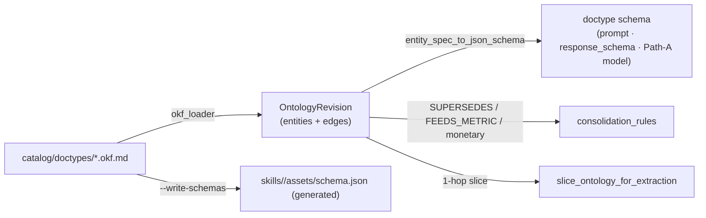

# Ontology — what a document *is*

> One OKF bundle per doctype says what the document is, which fields it carries, how to tell it from its look-alikes, and how it relates to other doctypes. It is the canonical source for field names, types, `required`, closed vocabularies, tables and graph edges; everything else that needs a doctype's shape is rendered from it.

**Where it lives.** `catalog/doctypes/<entity_id>.okf.md` — YAML front-matter in OKF v0.2 followed by a human-facing Markdown body. The directory is `BRIDGE_OKF_DOCTYPES_DIR` when set, else the repo's `catalog/doctypes/`. The loader is `bridge/refinery/okf_loader.py`; the wire types it fills are in `contract/refinery.py` (`OntologyEntitySpec`, `OntologyFieldSpec`, `OntologyEdge`, `ContrastiveDescription`, `OntologyRevision`). Three front-matter keys carry JSON-Schema-only shape the frozen contract models do not hold — `fields.<name>.enum`, `tables`, `schema_version` — so they ride next to the typed spec in the loader's `OkfDoctypeBundle` rather than inside it.



## The grammar as parsed

**Entity header.** `okf_version` (`"0.2"`), `entry_type` (`semantic-entity`), `entity_id` (defaults to the file stem; required), `context_set`, `revision_id` (default `ont-rev-v1-1-baseline`), `source_priority` (int, default 20 — the consolidation authority tier), `schema_version` (the generated asset's `version` marker), `aliases` (other names a caller or a model may use for this doctype), `declares_issuer` (bool; whether `issuer` is a first-class extracted field) and `issuer_description`, and `entity_description` — a three-part **contrastive description** `{what_it_is, where_to_read, distinguish_from}` (a plain string is accepted as `what_it_is`).

**Fields.** `fields.<name>` with `type` (default `string`; every declared property arrives on the wire as a string — coercion is a values concern), `required`, `monetary` (feeds the Decimal money path in consolidation), `synonyms` (the labels a carrier prints), `enum` (a closed string vocabulary, typed as a `Literal` in the Path-A model), `feeds_metric` (the summary bucket the value contributes to) and `description` — the same three-part contrastive shape.

**Tables.** `tables.<name>` with `description`, `required` (column names) and `columns.<col>.{type, enum, description}` for row-shaped data such as a carrier rate sheet; an entry without columns is dropped.

**Edges.** `edges[]` with `relation`, `target_id`, optional `edge_id` (else `edge-<entity>-<relation>-<n>`), `source_id` (defaults to the entity), `priority_rank`, `on_fields`, `metric_operation`, `condition_expr` and `effective_from_revision` (defaults to the bundle's revision). `relation` is `contract/refinery.py::EdgeRelation`: `SUPERSEDES`, `FEEDS_METRIC`, `REQUIRES_CORROBORATION`, `ALIAS_OF`, `DISTINCT_FROM`, `SPLIT_FROM`, `MERGED_INTO`, `ALIASED_FROM`, `INCLUDES`, `EXCLUDES`.

**Revisions.** `build_baseline_ontology_revision` folds every bundle into one immutable `OntologyRevision` (`ont-rev-v1-1-baseline`, version `1.1.0`, state `ACTIVE`, a SHA-256 over entities + edges). A Zone 6 `KnowledgeCatalog` (`bridge/knowledge_catalog/`, backed by `SqlKnowledgeCatalog` via `Port.knowledge_catalog`) holds promoted revisions (`DRAFT → ASSAY → SHADOW → ACTIVE → DEPRECATED`) across `catalog_ontology_revisions` and `catalog_ontology_edges` on the shared `DsnSqlRuntime` and mirrors them to BigQuery (`bq_ontology_revisions`, `bq_ontology_edges`); `get_active_ontology_revision()` is what consumers ask for, and `knowledge_catalog_from_env()` resolves `Port.knowledge_catalog`. The Markdown body after the front-matter is not parsed into the spec; `render_okf_markdown` writes it back when the Refinery serializes a revision.

## Example — `catalog/doctypes/cre-credit-agreement.okf.md` (excerpt)

```yaml
okf_version: "0.2"
entry_type: semantic-entity
entity_id: cre-credit-agreement
context_set: commercial-and-residential-lending
revision_id: ont-rev-v1-1-baseline
source_priority: 30
aliases: [credit-agreement, loan-agreement, policy, binder]
declares_issuer: true
issuer_description: "Administrative agent, lead arranger, syndicated lender group, or issuing bank."
entity_description:
  what_it_is: >
    Commercial Real Estate (CRE) Credit Agreement, Syndicated Term Sheet, or
    Initial Loan Estimate establishing committed facility limits, base
    origination fees, and underwritten Net Operating Income (NOI) covenants.
  where_to_read: >
    Identified by "Credit Agreement", "Senior Term Loan Facility Term Sheet",
    or "Loan Estimate" headers and the Summary of Principal Terms schedule.
  distinguish_from: >
    Do NOT confuse with a final TRID Closing Disclosure or signed Schedule B
    Fee Addendum (`trid-closing-disclosure`), which carries higher settlement
    authority (`priority 40`), or with a standalone property valuation report
    (`mai-appraisal`).
fields:
  loan_amount:
    type: string
    required: true
    monetary: true
    feeds_metric: total_coverage_limit
    synonyms: ["Senior Term Loan Facility", "Committed Principal Amount", "Loan Amount"]
    description:
      what_it_is: "Committed principal loan facility amount in the agreement's currency."
      where_to_read: "Summary of Terms / Article II Commitments."
      distinguish_from: "Do NOT extract uncommitted accordion expansion options or appraised collateral value."
edges:
  - edge_id: edge-credit-agreement-supersedes-appraisal
    relation: SUPERSEDES
    target_id: mai-appraisal
    priority_rank: 30
    on_fields: ["net_operating_income"]
    condition_expr: "source.effective_from >= target.effective_from"
  - edge_id: edge-credit-agreement-feeds-limit
    relation: FEEDS_METRIC
    target_id: FinancialSummary.total_coverage_limit
    on_fields: ["loan_amount", "facility_limit"]
    metric_operation: SUM_ACTIVE_DECIMAL
```

## How it is consumed

- **One rendering.** `bridge/doctypes.py::entity_spec_to_json_schema` is the single rendering of a bundle as a doctype schema (`properties.doctype`, `properties.issuer` when `declares_issuer`, `properties.key_fields.{properties,required}`, `properties.tables`, the rendered contrastive descriptions, `x_okf_revision_id`), with fixed key order so the serialized file is byte-stable.
- **Schema reader.** `bridge/doctypes.py::doctype_schemas` lists installed doctype skills through the `skill_registry` port and, for every doctype with a bundle, renders the schema from the bundle — never from the skill's asset. When the catalog's active revision is beyond baseline, that revision's entity spec replaces the file's field set while the bundle's enum and table extras still apply, and newly promoted child entities join the catalog. A doctype without a bundle keeps the asset path, enriched with the OKF descriptions when a spec exists.
- **Extraction.** `bridge/extraction/gemini_schema.py::build_extraction_prompt` renders each entity's and field's contrastive description into the installed-doctype catalog and `build_response_schema` pins the field union; `slice_ontology_for_extraction` narrows both to the target or candidate doctypes plus their 1-hop graph neighbourhood ([extraction](extraction.md)).
- **Path-A validation.** `key_field_model` / `tables_model` build the typed Pydantic model an asserted extraction must satisfy from the same schema (`required` mandatory, `extra="forbid"`, enums as `Literal`), so the validator and the prompt cannot disagree ([A2A edge](a2a-edge.md#dual-path-fulfillment)).
- **Consolidation.** `bridge/operational_store/consolidation_rules.py::source_priority_for_doctype` resolves a doctype (by `entity_id`, alias, or longest substring match) in the active revision and takes the `priority_rank` of its `SUPERSEDES` / `SPLIT_FROM` edge, else the entity's `source_priority`; a doctype no revision knows falls back to a fixed token tier (40 / 30 / 20 / 10). `FEEDS_METRIC` edges route a field into its `FinancialSummary` bucket and `monetary` marks it for the Decimal money path.
- **Lineage.** Every consolidated fact records the `ontology_revision_id` and edge id it was resolved under ([Schema Refinery](schema-refinery.md)).

## The generated asset and the consistency test

A doctype skill folder still ships `assets/schema.json` because the registry sync ships the folder as-is. That file is **generated**: `python -m bridge.refinery.okf_loader --write-schemas` renders it for every bundle whose skill folder exists; `--check` writes nothing and exits 1 when any on-disk asset is stale. `tests/test_doctype_consistency.py` holds the two together — every committed asset equals its bundle's rendering byte for byte, every doctype skill with a schema has a bundle, regeneration is a no-op on the committed tree, and the loader serves the bundle's rendering rather than the file. Editing a field in `assets/schema.json` by hand is therefore a test failure; the edit belongs in the bundle.

## Related
- [knowledge model](knowledge-model.md) · [skills](skills.md) (the installable unit that points at a bundle) · [extraction](extraction.md) · [Schema Refinery](schema-refinery.md) (how the ontology evolves) · [disposition](disposition.md)
