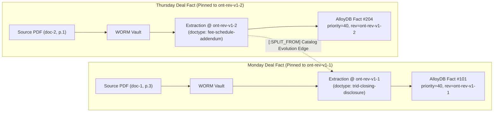

# Schema Refinery & Ontology-Driven Document Types

> Separates procedural **process workflows** (kept as ADK/A2A `AgentSkill`s) from declarative **document ontologies** (`doctype`s), moving `doctype` schemas, contrastive descriptions, authority hierarchies, and field-to-metric formulas into **Zone 6 Knowledge Catalog + Knowledge Graph** authored in **OKF (Open Knowledge Format)** and continuously evaluated and evolved by **Schema Refinery** over **AlloyDB** and **BigQuery**.

---

## 1. Motivation — the limits of flat doctype skills

Before the ontology layer, [`skills/`](../skills/) used a single packaging mechanism (`SKILL.md` folders parsed by [`bridge/edge/skills.py`](../bridge/edge/skills.py)) for two fundamentally different architectural layers:

1. **Procedural Process Skills (`bridge-kind: process`):** `commercial-loan-underwriting`, `benefits-procurement`, `address-proof`. These are true agent skills advertised as `AgentSkill` objects on `/.well-known/agent-card.json`, governing SLA timers (`assets/policy.yaml`), HITL parking (`bridge-hitl`), and multi-turn orchestration.
2. **Declarative Document Types (`bridge-kind: doctype`):** `trid-closing-disclosure`, `cre-credit-agreement`, `mai-appraisal`, `commercial-property-quote`, `utility-bill`, `gov-id`. These are **never advertised as standalone A2A skills** (`loaded_skills()` filters them out). They carry no tool code — only `assets/schema.json` and `assets/validation.yaml`.

Because a flat `skills/<doctype>/` folder can only describe one document type in isolation, four structural limitations followed; each names the code location it was observed at:

| Current Limitation | Exact Code Location | Impact |
| :--- | :--- | :--- |
| **1. Top-level Entity Descriptions Are Dropped Before Extraction** | `bridge/doctypes.py::doctype_schemas` & `bridge/extraction/gemini_schema.py::build_extraction_prompt` | `SKILL.md`'s top-level `description` is never passed to `GeminiExtractor`. `gemini-3.8-flash` (`thinking_budget=0`) only sees the hyphenated slug (`trid-closing-disclosure`) and flat field descriptions, forcing it to guess entity boundaries from the slug name. |
| **2. Cross-Document Authority Hierarchy Is Hardcoded in Python** | `bridge/operational_store/consolidation_rules.py::source_priority_for_doctype` | Document precedence (`closing-disclosure: 40 > credit-agreement: 30 > appraisal: 20`) is hardcoded via substring `if/elif` checks rather than declared as graph edges between document types. |
| **3. Field-to-Metric Mapping Is Duplicated in 3 Places** | `skills/trid-closing-disclosure/assets/schema.json`, `consolidation_rules.py::compute_financial_summary`, & `knowledge_catalog/models.py::DEFAULT_GLOSSARY_TERMS` | Adding a new industry domain requires editing Python lists (`_MONEY_KEYS` and `compute_financial_summary`) instead of declaring `(:DoctypeField)-[:FEEDS_METRIC]->(:GlossaryTerm)` in the catalog. |
| **4. No Mechanism to Evaluate or Evolve Entity Granularity** | `bridge/agent_gym/compiler.py::compile_rules_to_skill` | Agent Gym can append prompt bullets to an existing `doctype`, but cannot evaluate whether an overloaded entity type should be **split** (e.g., `trid-closing-disclosure` vs. `fee-schedule-addendum`), two colliding types should be **merged**, or a **missing entity type** should be added. |

---

## 2. The ontology layer the Refinery evolves

The declarative half — `process` = ADK skill, `doctype` = catalog entity authored in OKF v0.2 under `catalog/doctypes/`, parsed by `bridge/refinery/okf_loader.py` into `contract/refinery.py` types, rendered into the generated `assets/schema.json`, and consumed by extraction, Path-A validation and consolidation — is specified in [ontology](ontology.md). The Refinery below reads and writes that layer only: it never edits a process skill's policy ([skills](skills.md)) and never decides completeness ([knowledge model](knowledge-model.md)).

---

## 3. Schema Refinery: Evaluating & Evolving Entity Types, Descriptions, and Edges

**Schema Refinery** (`bridge/refinery/`) extends the continuous-learning loop beyond prompt hints to evaluate and evolve the ontology across **three levels**:
1. **Level 1 — Entity & Field Descriptions** (Semantic Disambiguation)
2. **Level 2 — Graph Edges & Consolidation Rules** (Precedence, Aliases, Metric Mappings)
3. **Level 3 — Entity Taxonomy & Granularity** (Splitting, Merging, or Adding Entity Types)

### 3.1 Evaluating If We Have the *Right Entity Types* (Taxonomy Assay)

Using BigQuery (`otel_spans` + `bq_operational_facts_iceberg`) and AlloyDB (`bridge_operational_facts` + `gym_feedback_signals`), Schema Refinery detects the four mathematical signatures of a flawed entity taxonomy:

| Taxonomy Defect | Quantitative Signal in BigQuery / AlloyDB | Schema Refinery Proposal Generated |
| :--- | :--- | :--- |
| **1. Missing Entity Type** *(Under-granularity)* | **Out-of-Ontology Escape Cluster:** In `PROMPT_FOOTER`, `fields.doctype` is a free string. When BigQuery detects $\ge N$ rejected/quarantined spans reporting the same unlisted `fields.doctype` slug (e.g., `"rent-roll"`, `"environmental-indemnity"`) with a consistent cluster of extracted keys, the catalog is missing a node. | **`ProposeNewEntity`:** `gemini-4-argon` drafts a candidate OKF entity definition, required/optional fields, and `[:FEEDS_METRIC]` edges. |
| **2. Overloaded Entity Type** *(1 Type Should Be Split into 2)* | **Bimodal Null / `absent_from_document` Distribution:** Within a single entity type (e.g., `trid-closing-disclosure`), AlloyDB computes the field-presence matrix across accepted/quarantined docs. If Cluster A populates `{loan_amount, appraised_value, origination_fee}` while Cluster B only populates `{origination_fee, effective_date}` and repeatedly triggers `absent_from_document` reviews on `appraised_value` (Jaccard distance $> 0.50$), one entity is overloading two distinct document types. | **`ProposeEntitySplit`:** Splits `trid-closing-disclosure` into `trid-closing-disclosure` (full closing statement) and `fee-schedule-addendum` (narrow fee override with `[:SUPERSEDES]` edge), eliminating false incomplete-document quarantines. |
| **3. Colliding / Redundant Types** *(2 Types Should Be Merged)* | **High Confusion + Identical Graph Neighborhood:** SMEs in Zone 2/5 frequently reclassify `Entity A ↔ Entity B` (or multi-window extraction in `chunking.py` flips between `A` and `B` across pages of the same PDF), **and** both entities share identical `source_priority` and downstream metric edges. | **`ProposeEntityMerge`:** Merges `Entity B` into `Entity A` as a catalog `synonym` and adds an `[:ALIASED_FROM]` lineage edge. |
| **4. Misplaced Required Field** | **Chronic `absent_from_document` Rate ($> 80\%$):** A field marked `required: true` on `Entity A` is missing on $>80\%$ of legitimate documents of that type, or SMEs repeatedly patch an undeclared field into `Entity A`. | **`ProposeFieldCardinalityChange`:** Demotes the field from `required` to `optional` (or migrates it to the sibling entity where it actually appears). |

### 3.2 Evaluating If We Have the *Right Descriptions* (Description Assay)

Even when the entity taxonomy is right, vague or positive-only descriptions cause classification flips and wrong-cell extraction on `gemini-3.8-flash` (`thinking_budget=0`). Schema Refinery evaluates description quality using the statistical calibration suite in `bridge/calibration.py`:

1. **Perturbation & Catalog-Order Stability (`krippendorff_alpha` & `agreement_at_k`):**
   - Permutes the ordering of entity and field descriptions in `build_extraction_prompt()` and runs synthetic layout shifts (`generate_synthetic_stress_suite`).
   - Any entity or field whose classification or extracted value drops below $\alpha = 0.80$ under catalog-order permutation is flagged as **semantically ambiguous**.
2. **Teacher–Workhorse Compression Gap (`gemini-4-argon` vs. `gemini-3.8-flash`):**
   - On BigQuery sampled traces (`v_trace_sql_evaluation`), compares `gemini-3.8-flash` outputs against `gemini-4-argon` and SME ground truth using `human_agent_swap()` and `gwets_ac2()`.
   - Where `gemini-4-argon` matches SMEs (`AC2 >= 0.90`) but `gemini-3.8-flash` fails (`AC2 < 0.75`), the description failed to compress the domain distinction for a zero-thinking workhorse model.
3. **Contrastive Description Synthesis (`what_it_is` / `where_to_read` / `distinguish_from`):**
   - `gemini-4-argon` rewrites the colliding entity or field descriptions to include explicit **negative boundary clauses** (`distinguish_from`) that separate the confused pair.

### 3.3 The 3-Tier Refinery Assay Gate (Before Any Promotion)

No candidate `OntologyChangeProposal` (description edit, edge addition, or entity split/merge) can be promoted until it passes all three tiers:

- **Tier 1 — Deterministic Graph & Structural Invariants (AlloyDB / Python):**
  - *Strict DAG Check:* Verifies `[:SUPERSEDES]` edges contain zero cycles.
  - *Decimal & Formula Integrity:* Verifies every `BusinessGlossaryTerm` formula resolves to valid `Decimal` fields and `Rule 0` (`FA=0` in `threshold_corridor()`) holds.
  - *Paired Removal Integrity:* Prevents removing or splitting an entity/field without an explicit migration edge (`[:SPLIT_FROM]`, `[:ALIASED_FROM]`) for downstream views and glossary terms.
- **Tier 2 — Counterfactual SQL Backtest over Historical Deals (BigQuery):**
  - Replays the candidate ontology graph in BigQuery Standard SQL over `bq_operational_facts_iceberg`: proves **zero regression** (`negative_flip_rate == 0.0%`) on all historically verified `FinancialSummary` outputs while quantifying how many historical `FactConflict`s or false quarantines the change resolves.
- **Tier 3 — Calibrated `gemini-4-argon` Judge + Rogan-Gladen Debiasing:**
  - Evaluates boundary documents via `AI.GENERATE_TABLE` and computes the bias-corrected pass rate via `rogan_gladen_debiased_pass_rate()`.

---

## 4. Production Execution: In-Flight Extractions, Parked Tasks, and Lineage

### 4.1 Snapshot Isolation for Running Extractions & Parked Deals

Ontology changes are never applied via in-place mutation. Every Refinery promotion creates an immutable **`OntologyRevisionRecord` (`ont-rev-v1-2-a8f3c1`)** in AlloyDB (`refinery_ontology_revisions`) progressing through `DRAFT` → `ASSAY` → `SHADOW` → `ACTIVE` → `DEPRECATED`.

| In-Flight Horizon | Production Pinning & Isolation Rule |
| :--- | :--- |
| **1. Multi-Window PDF Extraction in Flight** (`GeminiExtractor.extract()`) | **Per-Call Snapshot Pinning:** `self._catalog()` resolves `(prompt, response_schema, ontology_revision_id)` **once** at the entry of `extract()`. All concurrent page windows in `_extract_windows()` and all schema retries in `_generate_validated()` execute against that pinned snapshot. If `v1.2` becomes `ACTIVE` while a 40-page PDF is on window 3 of 5, all 5 windows complete under `v1.1` so `merge_window_results()` never mixes schemas. |
| **2. Submissions Parked in HITL Quarantine / A2UI Inbox** (`ActionInboxStore`) | **Pinned Validation + Optional Auto-Wake:** • Each parked task stamps the `ontology_revision_id` (`v1.1`) that produced it. When a human reviewer clicks `Accept` or `Edit & Approve`, validation runs against `v1.1` (so a new `required` field in `v1.2` never breaks human approval of a `v1.1` extraction). • When `v1.2` is promoted to `ACTIVE`, a background task can test unopened `Disposition.pending` items against `v1.2`; if `v1.2` resolves the ambiguity under `Gate.auto_approve`, it writes `version = v + 1` stamped with `v1.2` and closes the inbox item. |
| **3. Long-Lived Deal Packages Across Days** (`entity_id` / `context_id` in `SqlOperationalStore`) | **Canonical Field + Evolution-Edge Consolidation:** Document 1 (ingested Monday under `v1.1`) and Document 2 (ingested Thursday under `v1.2`) consolidate in `resolve_active_facts()` without re-extracting Document 1, because `ConsolidatedFact` stores the resolved numeric `source_priority` and canonical `field_path`, and `v1.2` carries explicit `[:SPLIT_FROM]` / `[:ALIASED_FROM]` edges mapping `v1.1` types to `v1.2`. |

### 4.2 Two-Dimensional Lineage (Bi-Temporal Fact Lineage + Schema Evolution Lineage)

In regulated banking and insurance workflows (SR 11-7), historical facts and audit trails are append-only and never overwritten. Zone 6 (`bridge/knowledge_catalog/catalog.py`) records two orthogonal lineage dimensions:

1. **As-Processed Instance Lineage (Audit Time-Travel):**
   - Every `ConsolidatedFact`, `SourceTrace`, and `LineageTrace` records `ontology_revision_id` (`ont-rev-v1-1`), `consolidation_edge_id`, and `process_skill_revision_id`.
   - Querying `trace_lineage(entity_id, field)` reconstructs the exact 6-hop chain using the entity definition, description, and priority edge that was active when that fact was recorded.
2. **Cross-Revision Schema Lineage (`[:SPLIT_FROM]`, `[:MERGED_INTO]`, `[:ALIASED_FROM]`):**
   - When Schema Refinery splits `trid-closing-disclosure@v1.1` into `fee-schedule-addendum@v1.2`, it writes a `[:SPLIT_FROM]` link into AlloyDB (`ontology_edges`) and the BigQuery Property Graph.
   - Analytical queries in BigQuery (`bq_operational_facts_iceberg`) traverse `[:SPLIT_FROM]` / `[:ALIASED_FROM]` edges to aggregate metrics seamlessly across ontology versions without mutating historical AlloyDB rows.

---

## 5. Data Models & AlloyDB / BigQuery Schema

### 5.1 Wire Models (`contract/refinery.py`)

Shared by `bridge/` and `agents/`, all `extra="forbid"`, frozen:

- `ContrastiveDescription` — `what_it_is` / `where_to_read` / `distinguish_from`, with `render()` producing the one prompt/schema description string.
- `OntologyEdge` — `edge_id`, `source_id`, `relation` (`EdgeRelation`: `SUPERSEDES`, `FEEDS_METRIC`, `REQUIRES_CORROBORATION`, `ALIAS_OF`, `DISTINCT_FROM`, `SPLIT_FROM`, `MERGED_INTO`, `ALIASED_FROM`, `INCLUDES`, `EXCLUDES`), `target_id`, `priority_rank`, `on_fields`, `metric_operation`, `condition_expr`, `effective_from_revision`.
- `OntologyFieldSpec` / `OntologyEntitySpec` — the parsed OKF bundle ([ontology](ontology.md)).
- `RefineryProposalKind` — `REFINE_DESCRIPTION`, `UPSERT_EDGE`, `PROPOSE_NEW_ENTITY`, `SPLIT_ENTITY`, `MERGE_ENTITY`, `CHANGE_FIELD_CARDINALITY`; `RefineryProposalStatus` — `CANDIDATE`, `ASSAY_PASSED`, `ASSAY_FAILED`, `PROMOTED`, `REJECTED`.
- `RefineryProposal` — the candidate mutation: target entity / field, before and after descriptions, a proposed entity, added edges, migrated fields, evidence metrics, and the assay report and promoted revision it resolved to.
- `RefineryAssayReport` — the 3-tier scorecard: Tier 1 flags (`dag_acyclic`, `decimal_formulas_valid`, `corridor_fa_zero`, `paired_removal_intact`), Tier 2 replay (`replayed_deal_count`, `negative_flip_rate`, `conflicts_resolved_delta`, `quarantine_reduction_delta`), Tier 3 calibration (`perturbation_krippendorff_alpha`, `workhorse_teacher_ac2`, `rogan_gladen_pass_rate`, bimodal Jaccard similarity / distance), `passed`.
- `OntologyRevision` — `revision_id`, `version`, `parent_revision_id`, `state` (`OntologyRevisionState`: `DRAFT`, `ASSAY`, `SHADOW`, `ACTIVE`, `DEPRECATED`), `content_sha256`, `entities`, `edges`, `promoted_proposal_ids`, bi-temporal `effective_from` / `effective_to` / `recorded_at`.

### 5.2 AlloyDB Tables (`bridge/refinery/sql_store.py`, shared on `DsnSqlRuntime` in `bridge/sql_runtime.py`)

1. `refinery_ontology_revisions`: `(revision_id PK, parent_revision_id, semver, state [DRAFT|ASSAY|SHADOW|ACTIVE|DEPRECATED], okf_bundle_json, archive_sha256, created_at)`
2. `refinery_proposals`: `(proposal_id PK, kind, target_entity_id, proposed_diff_json, status, trigger_signal_ids_json, created_at)`
3. `refinery_assay_reports`: `(assay_id PK, proposal_id FK, report_json, passed_assay, evaluated_at)`

---

## 6. Phased Migration Plan (`main`)

> **Unified Branch Status:** Phases 1–4 (`P8-1`–`P8-4` in [`docs/roadmap.md`](../docs/roadmap.md)) are implemented and merged into `main`. Phases 5–8 (`P8-5`–`P8-8`) and `FX-1` track the next roadmap milestones.

| Task / Phase | Scope | Verification Gate |
| :--- | :--- | :--- |
| **`P8-1` — Phase 1: Contrastive Descriptions & OKF Loader (Non-Breaking)** | Extend `bridge/doctypes.py` and `bridge/extraction/gemini_schema.py` to read top-level entity descriptions and contrastive (`what_it_is` / `where_to_read` / `distinguish_from`) field metadata from `catalog/doctypes/*.okf.md` / `SKILL.md` into `build_extraction_prompt()` and `build_response_schema()` across Insurance (`commercial-property-quote`, `benefits-quote`) and Banking/Mortgage (`trid-closing-disclosure`, `cre-credit-agreement`, `mai-appraisal`). | Existing `1,871` unit tests pass + new `tests/test_schema_refinery_okf.py` perturbation $\alpha \ge 0.80$ tests. |
| **`P8-2` — Phase 2: Graph-Driven Consolidation in Zone 3 & Zone 6** | Add `contract/refinery.py` wire models and replace hardcoded `if/elif` doctype priorities and `_MONEY_KEYS` in `bridge/operational_store/consolidation_rules.py` with graph lookups (`[:SUPERSEDES]` and `[:FEEDS_METRIC]`) loaded from the active `OntologyRevision` in Zone 6 `KnowledgeCatalog`. | `tests/test_enterprise_data_architecture.py` and `tests/test_documentation_contract.py` pass with 100% identical financial rollups across `terrepower-coastal-2027`, `LOAN-MERIDIAN-001`, and `MORTGAGE-WESTBROOK-2026`. |
| **`P8-3` — Phase 3: Schema Refinery Engine (`bridge/refinery/`)** | Implement taxonomy assay detectors (bimodal null split detector, escape-slug new-entity detector, confusion merge detector), contrastive description optimizer, 3-Tier Assay Gate (`RefineryAssayReport`), and bi-temporal `ontology_revision_id` + `[:SPLIT_FROM]` lineage tracking across AlloyDB (`DsnSqlRuntime`) and BigQuery. | End-to-end test in `tests/test_schema_refinery_engine.py`: both Insurance (`commercial-property-quote` endorsement vs. base quote refinement on `terrepower-coastal-2027`) and CRE/Mortgage (`trid-closing-disclosure` → `fee-schedule-addendum` split) evolve `ont-rev-v1-1` → `ont-rev-v1-2` with historical `v1.1` lineage intact. |
| **`P8-4` — Phase 4: Interactive Showcase Tab & Insurance-First Mode (`/demo` with `BRIDGE_DEFAULT_DEMO_DOMAIN=insurance`)** | Mount `/v1/refinery/*` routes and add the **Schema Refinery** interactive workflow to `demo/enterprise-demo.html` + `demo/enterprise-demo.js` (bimodal field analysis, contrastive description diff, 3-Tier BigQuery counterfactual assay, and live ontology promotion with `[:SPLIT_FROM]` lineage), plus `?domain=insurance` / `BRIDGE_DEFAULT_DEMO_DOMAIN=insurance` default domain routing for the insurance-first showcase deployment. | Full Playwright & `tests/test_documentation_contract.py` test suite passes. |
| **`P8-5` — Phase 5: Example-Driven Doctype Onboarding (`bridge/refinery/`)** | Because DocuBridge acts as a document-mediation executor for upstream agents rather than a warehouse crawler, provide an example-driven onboarding workflow (`onboard_doctype_from_examples`): given 1–5 sample documents or structured examples plus an optional `context_set`, `gemini-4-argon` synthesizes a candidate `.okf.md` entity bundle (`ContrastiveDescription`, `synonyms`, `[:FEEDS_METRIC]`, `[:SUPERSEDES]`) in `DRAFT` state and evaluates it through the 3-Tier Assay Gate. | Unit + assay tests verify end-to-end draft synthesis and 3-Tier Assay Gate validation from sample document fixtures. |
| **`P8-6` — Phase 6: Target-Scoped Ontology Slicing per Extraction Call (`bridge/extraction/`)** | Instead of injecting the union of every installed doctype into every extraction call, scope `build_extraction_prompt()`, `build_response_schema()`, and `GeminiExtractor.extract()` to the known target `doctype` or active process `candidate_doctypes` (`context_set`) plus their 1-hop ontology neighborhood (`[:SUPERSEDES]`, `[:SPLIT_FROM]`, `[:DISTINCT_FROM]`), while keeping `fields.doctype` as a free string so out-of-label-space uploads still report their observed type. | Extraction prompt/schema unit tests verify scoped schema construction, reduced token footprint, and preserved out-of-label-space (`unsupported`) disposition. |
| **`P8-7` — Phase 7: Read-Only Allow-Listed Ontology MCP Surface (`bridge/knowledge_catalog/`)** | Expose a strictly read-only, allow-listed MCP toolset over Zone 6 `KnowledgeCatalog` (`get_entity_ontology`, `explain_metric_formula`, `check_doctype_precedence`, `trace_field_lineage`) for calling agents, keeping all state-changing ontology mutations (`onboard_doctype_from_examples`, `register_proposal`, `promote_proposal`) isolated to the Assay-Gated admin control plane. | Contract and unit tests verify read-only MCP tool schemas, deterministic responses, and zero mutation tools on the MCP surface. |
| **`P8-8` — Phase 8: Pre-Execution Query & Metric Formula Validator (`bridge/knowledge_catalog/`)** | Validate Zone 5 Domain Agent queries and analytical rollups over `OperationalStore` and BigQuery (`bq_operational_facts_iceberg`) against certified `[:FEEDS_METRIC]` edges, bi-temporal watermarks (`learned_as_of`, `effective_on`), and `[:SUPERSEDES]` active-fact precedence before execution. | Unit tests verify rejection of uncertified metric aggregations or queries missing bi-temporal/precedence resolution predicates. |

## 7. Future Experiments

- **`FX-1` — 3-Arm Ontology Ablation Benchmark (`RefineryAssayReport`):** Extend `evaluate_ontology_proposal()` to score candidate ontology revisions across three explicit ablation arms—**Arm 0 (Schema-Only Control:** flat JSON `field: type` with no contrastive descriptions or graph edges), **Arm 1 (+ Contrastive Descriptions:** adding `what_it_is` / `where_to_read` / `distinguish_from` to isolate Stage-1 `gemini-3.8-flash` extraction lift), and **Arm 2 (+ Full Ontology Graph:** adding `[:SUPERSEDES]`, `[:INCLUDES]` / `[:EXCLUDES]`, and `[:SPLIT_FROM]` edges to isolate Stage-2 consolidation conflict-resolution lift and quarantine reduction).

## Related
- [knowledge model](knowledge-model.md) · [ontology](ontology.md) · [Agent Gym & Programmable Trust](agent-gym.md) · [Agent Gym × Harness Evolve](harness-evolve.md) · [skills](skills.md) · [ports](ports.md) · [disposition](disposition.md)
