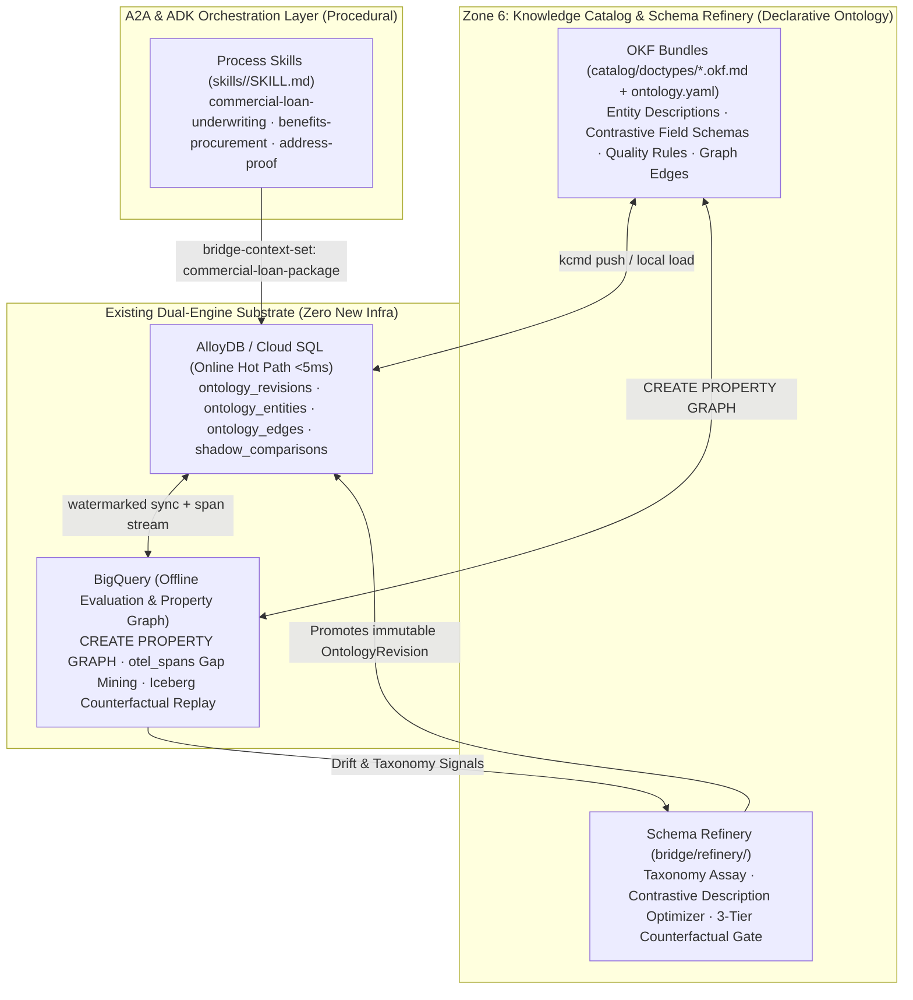
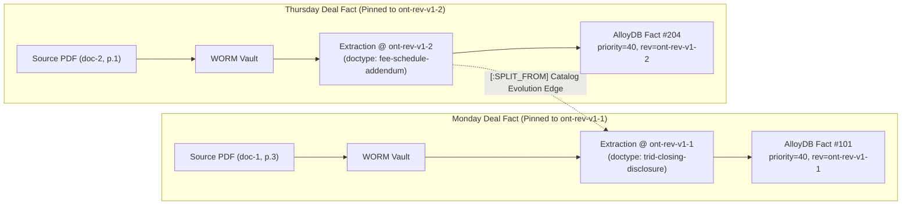

# Schema Refinery & Ontology-Driven Document Types

> **Architecture Proposal (Approved 2026-10-29):** Separates procedural **process workflows** (kept as ADK/A2A `AgentSkill`s) from declarative **document ontologies** (`doctype`s), moving `doctype` schemas, contrastive descriptions, authority hierarchies, and field-to-metric formulas into **Zone 6 Knowledge Catalog + Knowledge Graph** authored in **OKF (Open Knowledge Format)** and continuously evaluated and evolved by **Schema Refinery** over **AlloyDB** and **BigQuery**.

---

## 1. Problem Statement & Motivation

Today, [`skills/`](../skills/) uses a single packaging mechanism (`SKILL.md` folders parsed by [`bridge/edge/skills.py`](../bridge/edge/skills.py)) for two fundamentally different architectural layers:

1. **Procedural Process Skills (`bridge-kind: process`):** `commercial-loan-underwriting`, `benefits-procurement`, `address-proof`. These are true agent skills advertised as `AgentSkill` objects on `/.well-known/agent-card.json`, governing SLA timers (`assets/policy.yaml`), HITL parking (`bridge-hitl`), and multi-turn orchestration.
2. **Declarative Document Types (`bridge-kind: doctype`):** `trid-closing-disclosure`, `cre-credit-agreement`, `mai-appraisal`, `commercial-property-quote`, `utility-bill`, `gov-id`. These are **never advertised as standalone A2A skills** (`loaded_skills()` filters them out). They carry no tool code — only `assets/schema.json` and `assets/validation.yaml`.

Because flat `skills/<doctype>/` folders can only describe one document type in isolation, four structural limitations exist in the current codebase:

| Current Limitation | Exact Code Location | Impact |
| :--- | :--- | :--- |
| **1. Top-level Entity Descriptions Are Dropped Before Extraction** | `bridge/doctypes.py::doctype_schemas` & `bridge/extraction/gemini_schema.py::build_extraction_prompt` | `SKILL.md`'s top-level `description` is never passed to `GeminiExtractor`. `gemini-3.8-flash` (`thinking_budget=0`) only sees the hyphenated slug (`trid-closing-disclosure`) and flat field descriptions, forcing it to guess entity boundaries from the slug name. |
| **2. Cross-Document Authority Hierarchy Is Hardcoded in Python** | `bridge/operational_store/consolidation_rules.py::source_priority_for_doctype` | Document precedence (`closing-disclosure: 40 > credit-agreement: 30 > appraisal: 20`) is hardcoded via substring `if/elif` checks rather than declared as graph edges between document types. |
| **3. Field-to-Metric Mapping Is Duplicated in 3 Places** | `skills/trid-closing-disclosure/assets/schema.json`, `consolidation_rules.py::compute_financial_summary`, & `knowledge_catalog/models.py::DEFAULT_GLOSSARY_TERMS` | Adding a new industry domain requires editing Python lists (`_MONEY_KEYS` and `compute_financial_summary`) instead of declaring `(:DoctypeField)-[:FEEDS_METRIC]->(:GlossaryTerm)` in the catalog. |
| **4. No Mechanism to Evaluate or Evolve Entity Granularity** | `bridge/agent_gym/compiler.py::compile_rules_to_skill` | Agent Gym can append prompt bullets to an existing `doctype`, but cannot evaluate whether an overloaded entity type should be **split** (e.g., `trid-closing-disclosure` vs. `fee-schedule-addendum`), two colliding types should be **merged**, or a **missing entity type** should be added. |

---

## 2. Target Architecture: OKF + Knowledge Catalog + AlloyDB/BigQuery Graph

### 2.1 Clean Separation: `process` = ADK Skill, `doctype` = Catalog Entity



### 2.2 How Every Current `doctype` Artifact Maps to the New Model

| Current `doctype` Artifact | New Representation | Runtime Consumer |
| :--- | :--- | :--- |
| **`SKILL.md` Frontmatter & Prose** | **OKF Entity Header & Contrastive Entity Description** (`what_it_is`, `where_to_read`, `distinguish_from`) | `build_extraction_prompt()` and `build_response_schema()` include the entity's contrastive description so `gemini-3.8-flash` disambiguates boundary documents accurately. |
| **`assets/schema.json`** | **Knowledge Catalog `Entry` (`semantic-entity`) + Schema Aspect** (`fields`, `tables`, `synonyms`, `monetary_unit`) | `doctype_schemas()` reads from the active `OntologyRevision` in AlloyDB (or local OKF in `PortMode.LOCAL`), feeding both Path A Pydantic `create_model` and Path B Gemini structured output. |
| **`assets/validation.yaml`** | **Catalog `QualityRule` & `sql-expressions` Aspects** | Unifies Zone 2 intake validation (`Rule 0`) with Zone 6 `QualityRule` definitions. |
| **Hardcoded `source_priority_for_doctype` & `_MONEY_KEYS`** | **Knowledge Graph Edges (`EntryLinks`)**:<br>• `(:Doctype)-[:SUPERSEDES {priority: 40, fields: [...]}]->(:Doctype)`<br>• `(:DoctypeField)-[:FEEDS_METRIC {op: "sum"}]->(:GlossaryTerm)`<br>• `(:Process)-[:REQUIRES_CORROBORATION {distinct_issuer: true}]->(:Doctype)` | `consolidate_entry()`, `resolve_active_facts()`, and `compute_financial_summary()` become 100% graph-driven with zero hardcoded domain strings. |

### 2.3 Example OKF Doctype & Graph Definition (`catalog/doctypes/trid-closing-disclosure.okf.md`)

By authoring doctypes in **OKF**, `PortMode.LOCAL` reads the Markdown/YAML files directly from disk in milliseconds (preserving ADR-01 offline unit testing), while `PortMode.GCP` syncs them into Google Cloud Knowledge Catalog (`dataplex.googleapis.com`) and AlloyDB:

```markdown
---
okf_version: "0.2"
entry_type: semantic-entity
entity_id: trid-closing-disclosure
context_set: commercial-loan-package
revision_id: ont-rev-v1-1-baseline
source_priority: 40
entity_description:
  what_it_is: "Final CFPB TILA-RESPA Integrated Disclosure (TRID) Closing Disclosure or executed commercial loan closing settlement statement."
  where_to_read: "Inspect Page 1 Loan Terms table for principal and Page 3 Section A (or attached Schedule B addendum) for final origination and rate-lock fees."
  distinguish_from: "Do NOT classify preliminary Loan Estimates, non-binding Term Sheets, or standalone base Credit Agreements (cre-credit-agreement) as trid-closing-disclosure."
fields:
  loan_amount:
    type: Decimal
    required: true
    synonyms: ["Principal Loan Amount", "Total Facility Principal"]
    description:
      what_it_is: "Final bound principal loan facility amount at closing."
      where_to_read: "Page 1, Loan Terms -> Loan Amount."
      distinguish_from: "Excludes appraised collateral value (appraised_value) or uncommitted accordion capacity."
    feeds_metric: "term.loan_to_value_ratio.numerator"
  appraised_value:
    type: Decimal
    required: false
    synonyms: ["Appraised Property Value", "Collateral Valuation"]
    description:
      what_it_is: "Verified appraised value of the underlying real estate collateral."
      where_to_read: "Page 1, Transaction Information / Property Valuation."
      distinguish_from: "Excludes loan principal (loan_amount) or replacement cost insurance TIV."
    feeds_metric: "term.loan_to_value_ratio.denominator"
  origination_fee:
    type: Decimal
    required: true
    synonyms: ["Schedule B Rate-Lock Extension Fee", "Lender Origination Charge", "Points"]
    description:
      what_it_is: "Total binding origination and rate-lock extension fee charged by the lender."
      where_to_read: "Prioritize executed Schedule B / Page 3 Section A itemization over Page 1 summary estimates."
      distinguish_from: "Excludes third-party title insurance premiums, recording taxes, or appraisal fees."
    feeds_metric: "term.total_deductible_or_fees"
edges:
  - rel: SUPERSEDES
    target: cre-credit-agreement
    priority_rank: 40
    on_fields: ["origination_fee", "loan_amount"]
---
```

---

## 3. Schema Refinery: Evaluating & Evolving Entity Types, Descriptions, and Edges

**Schema Refinery** (`bridge/refinery/`) extends the continuous-learning loop beyond prompt hints to evaluate and evolve the ontology across **three levels**:
1. **Level 1 — Entity & Field Descriptions** (Semantic Disambiguation)
2. **Level 2 — Graph Edges & Consolidation Rules** (Precedence, Aliases, Metric Mappings)
3. **Level 3 — Entity Taxonomy & Granularity** (Splitting, Merging, or Adding Entity Types)

### 3.1 Evaluating If We Have the *Right Entity Types* (Taxonomy Assay)

Using BigQuery (`otel_spans` + `bq_operational_facts_iceberg`) and AlloyDB (`bridge_operational_facts` + `gym_feedback_signals`), Schema Refinery detects the four mathematical signatures of a flawed entity taxonomy:

| Taxonomy Defect | Quantitative Signal in BigQuery / AlloyDB | Schema Refinery Proposal Generated |
| :--- | :--- | :--- |
| **1. Missing Entity Type**<br>*(Under-granularity)* | **Out-of-Ontology Escape Cluster:** In `PROMPT_FOOTER`, `fields.doctype` is a free string. When BigQuery detects $\ge N$ rejected/quarantined spans reporting the same unlisted `fields.doctype` slug (e.g., `"rent-roll"`, `"environmental-indemnity"`) with a consistent cluster of extracted keys, the catalog is missing a node. | **`ProposeNewEntity`:** `gemini-4-argon` drafts a candidate OKF entity definition, required/optional fields, and `[:FEEDS_METRIC]` edges. |
| **2. Overloaded Entity Type**<br>*(1 Type Should Be Split into 2)* | **Bimodal Null / `absent_from_document` Distribution:** Within a single entity type (e.g., `trid-closing-disclosure`), AlloyDB computes the field-presence matrix across accepted/quarantined docs. If Cluster A populates `{loan_amount, appraised_value, origination_fee}` while Cluster B only populates `{origination_fee, effective_date}` and repeatedly triggers `absent_from_document` reviews on `appraised_value` (Jaccard distance $> 0.50$), one entity is overloading two distinct document types. | **`ProposeEntitySplit`:** Splits `trid-closing-disclosure` into `trid-closing-disclosure` (full closing statement) and `fee-schedule-addendum` (narrow fee override with `[:SUPERSEDES]` edge), eliminating false incomplete-document quarantines. |
| **3. Colliding / Redundant Types**<br>*(2 Types Should Be Merged)* | **High Confusion + Identical Graph Neighborhood:** SMEs in Zone 2/5 frequently reclassify `Entity A ↔ Entity B` (or multi-window extraction in `chunking.py` flips between `A` and `B` across pages of the same PDF), **and** both entities share identical `source_priority` and downstream metric edges. | **`ProposeEntityMerge`:** Merges `Entity B` into `Entity A` as a catalog `synonym` and adds an `[:ALIASED_FROM]` lineage edge. |
| **4. Misplaced Required Field** | **Chronic `absent_from_document` Rate ($> 80\%$):** A field marked `required: true` on `Entity A` is missing on $>80\%$ of legitimate documents of that type, or SMEs repeatedly patch an undeclared field into `Entity A`. | **`ProposeFieldCardinalityChange`:** Demotes the field from `required` to `optional` (or migrates it to the sibling entity where it actually appears). |

### 3.2 Evaluating If We Have the *Right Descriptions* (Description Assay)

Even when the entity taxonomy is right, vague or positive-only descriptions cause classification flips and wrong-cell extraction on `gemini-3.8-flash` (`thinking_budget=0`). Schema Refinery evaluates description quality using the statistical calibration suite in `bridge/calibration.py`:

1. **Perturbation & Catalog-Order Stability (`krippendorff_alpha` & `agreement_at_k`):**
   - Permutes the ordering of entity and field descriptions in `build_extraction_prompt()` and runs synthetic layout shifts (`generate_synthetic_stress_suite`).
   - Any entity or field whose classification or extracted value drops below $\alpha = 0.80$ under catalog-order permutation is flagged as **semantically ambiguous**.
2. **Teacher–Workhorse Compression Gap (`gemini-4-argon` vs. `gemini-3.8-flash`):**
   - On BigQuery sampled traces (`v_trace_sql_evaluation`), compares `gemini-3.8-flash` outputs against `gemini-4-argon` and SME ground truth using `human_agent_swap()` and `gwets_ac2()`.
   - Where `gemini-4-argon` matches SMEs (`AC2 >= 0.90`) but `gemini-3.8-flash` fails (`AC2 < 0.75`), the description failed to compress the domain distinction for a zero-thinking workhorse model.
3. **Contrastive Description Synthesis (`what_it_is` / `where_to_read` / `distinguish_from`):**
   - `gemini-4-argon` rewrites the colliding entity or field descriptions to include explicit **negative boundary clauses** (`distinguish_from`) that separate the confused pair.

### 3.3 The 3-Tier Refinery Assay Gate (Before Any Promotion)

No candidate `OntologyChangeProposal` (description edit, edge addition, or entity split/merge) can be promoted until it passes all three tiers:

- **Tier 1 — Deterministic Graph & Structural Invariants (AlloyDB / Python):**
  - *Strict DAG Check:* Verifies `[:SUPERSEDES]` edges contain zero cycles.
  - *Decimal & Formula Integrity:* Verifies every `BusinessGlossaryTerm` formula resolves to valid `Decimal` fields and `Rule 0` (`FA=0` in `threshold_corridor()`) holds.
  - *Paired Removal Integrity:* Prevents removing or splitting an entity/field without an explicit migration edge (`[:SPLIT_FROM]`, `[:ALIASED_FROM]`) for downstream views and glossary terms.
- **Tier 2 — Counterfactual SQL Backtest over Historical Deals (BigQuery):**
  - Replays the candidate ontology graph in BigQuery Standard SQL over `bq_operational_facts_iceberg`: proves **zero regression** (`negative_flip_rate == 0.0%`) on all historically verified `FinancialSummary` outputs while quantifying how many historical `FactConflict`s or false quarantines the change resolves.
- **Tier 3 — Calibrated `gemini-4-argon` Judge + Rogan-Gladen Debiasing:**
  - Evaluates boundary documents via `AI.GENERATE_TABLE` and computes the bias-corrected pass rate via `rogan_gladen_debiased_pass_rate()`.

---

## 4. Production Execution: In-Flight Extractions, Parked Tasks, and Lineage

### 4.1 Snapshot Isolation for Running Extractions & Parked Deals

Ontology changes are never applied via in-place mutation. Every Refinery promotion creates an immutable **`OntologyRevisionRecord` (`ont-rev-v1-2-a8f3c1`)** in AlloyDB (`refinery_ontology_revisions`) progressing through `DRAFT` → `ASSAY` → `SHADOW` → `ACTIVE` → `DEPRECATED`.

| In-Flight Horizon | Production Pinning & Isolation Rule |
| :--- | :--- |
| **1. Multi-Window PDF Extraction in Flight**<br>(`GeminiExtractor.extract()`) | **Per-Call Snapshot Pinning:** `self._catalog()` resolves `(prompt, response_schema, ontology_revision_id)` **once** at the entry of `extract()`. All concurrent page windows in `_extract_windows()` and all schema retries in `_generate_validated()` execute against that pinned snapshot. If `v1.2` becomes `ACTIVE` while a 40-page PDF is on window 3 of 5, all 5 windows complete under `v1.1` so `merge_window_results()` never mixes schemas. |
| **2. Submissions Parked in HITL Quarantine / A2UI Inbox**<br>(`ActionInboxStore`) | **Pinned Validation + Optional Auto-Wake:**<br>• Each parked task stamps the `ontology_revision_id` (`v1.1`) that produced it. When a human reviewer clicks `Accept` or `Edit & Approve`, validation runs against `v1.1` (so a new `required` field in `v1.2` never breaks human approval of a `v1.1` extraction).<br>• When `v1.2` is promoted to `ACTIVE`, a background task can test unopened `Disposition.pending` items against `v1.2`; if `v1.2` resolves the ambiguity under `Gate.auto_approve`, it writes `version = v + 1` stamped with `v1.2` and closes the inbox item. |
| **3. Long-Lived Deal Packages Across Days**<br>(`entity_id` / `context_id` in `SqlOperationalStore`) | **Canonical Field + Evolution-Edge Consolidation:**<br>Document 1 (ingested Monday under `v1.1`) and Document 2 (ingested Thursday under `v1.2`) consolidate in `resolve_active_facts()` without re-extracting Document 1, because `ConsolidatedFact` stores the resolved numeric `source_priority` and canonical `field_path`, and `v1.2` carries explicit `[:SPLIT_FROM]` / `[:ALIASED_FROM]` edges mapping `v1.1` types to `v1.2`. |

### 4.2 Two-Dimensional Lineage (Bi-Temporal Fact Lineage + Schema Evolution Lineage)

In regulated banking and insurance workflows (SR 11-7), historical facts and audit trails are append-only and never overwritten. Zone 6 (`bridge/knowledge_catalog/catalog.py`) records two orthogonal lineage dimensions:



1. **As-Processed Instance Lineage (Audit Time-Travel):**
   - Every `ConsolidatedFact`, `SourceTrace`, and `LineageTrace` records `ontology_revision_id` (`ont-rev-v1-1`), `consolidation_edge_id`, and `process_skill_revision_id`.
   - Querying `trace_lineage(entity_id, field)` reconstructs the exact 6-hop chain using the entity definition, description, and priority edge that was active when that fact was recorded.
2. **Cross-Revision Schema Lineage (`[:SPLIT_FROM]`, `[:MERGED_INTO]`, `[:ALIASED_FROM]`):**
   - When Schema Refinery splits `trid-closing-disclosure@v1.1` into `fee-schedule-addendum@v1.2`, it writes a `[:SPLIT_FROM]` link into AlloyDB (`ontology_edges`) and the BigQuery Property Graph.
   - Analytical queries in BigQuery (`bq_operational_facts_iceberg`) traverse `[:SPLIT_FROM]` / `[:ALIASED_FROM]` edges to aggregate metrics seamlessly across ontology versions without mutating historical AlloyDB rows.

---

## 5. Proposed Data Models & AlloyDB / BigQuery Schema Additions

### 5.1 New Pydantic Models (`bridge/refinery/models.py`)

```python
class ContrastiveDescription(BaseModel):
    """Three-part contrastive description for zero-thinking workhorse disambiguation."""
    model_config = ConfigDict(extra="forbid", frozen=True)

    what_it_is: str
    where_to_read: str = ""
    distinguish_from: str = ""


class OntologyEdge(BaseModel):
    """Directed edge in the Knowledge Catalog / Ontology Graph."""
    model_config = ConfigDict(extra="forbid", frozen=True)

    edge_id: str
    source_id: str
    relation: Literal[
        "SUPERSEDES",
        "FEEDS_METRIC",
        "REQUIRES_CORROBORATION",
        "ALIAS_OF",
        "DISTINCT_FROM",
        "SPLIT_FROM",
        "MERGED_INTO",
    ]
    target_id: str
    priority_rank: int | None = None
    on_fields: tuple[str, ...] = ()
    condition_expr: str | None = None


class RefineryProposalKind(StrEnum):
    REFINE_DESCRIPTION = "refine_description"
    UPSERT_EDGE = "upsert_edge"
    PROPOSE_NEW_ENTITY = "propose_new_entity"
    SPLIT_ENTITY = "split_entity"
    MERGE_ENTITY = "merge_entity"
    CHANGE_FIELD_CARDINALITY = "change_field_cardinality"


class RefineryAssayReport(BaseModel):
    """3-Tier Schema Refinery evaluation scorecard."""
    model_config = ConfigDict(extra="forbid", frozen=True)

    assay_id: str
    proposal_id: str
    # Tier 1: Deterministic Graph & Rule 0
    dag_acyclic: bool
    decimal_formulas_valid: bool
    paired_removal_intact: bool
    corridor_fa_zero: bool
    # Tier 2: BigQuery Historical Counterfactual Backtest
    historical_deals_replayed: int
    conflicts_resolved_delta: int
    negative_flip_rate: float  # Must be == 0.0
    bimodality_jaccard_before: float | None = None
    bimodality_jaccard_after: float | None = None
    # Tier 3: Statistical & Judge Calibration
    perturbation_krippendorff_alpha: float  # Must be >= 0.80
    workhorse_teacher_ac2: float            # Must be >= 0.80
    rogan_gladen_pass_rate: float
    passed_assay: bool
```

### 5.2 AlloyDB Tables (Shared on `DsnSqlRuntime` in `bridge/sql_runtime.py`)

1. `refinery_ontology_revisions`: `(revision_id PK, parent_revision_id, semver, state [DRAFT|ASSAY|SHADOW|ACTIVE|DEPRECATED], okf_bundle_json, archive_sha256, created_at)`
2. `refinery_proposals`: `(proposal_id PK, kind, target_entity_id, proposed_diff_json, status, trigger_signal_ids_json, created_at)`
3. `refinery_assay_reports`: `(assay_id PK, proposal_id FK, report_json, passed_assay, evaluated_at)`

---

## 6. Phased Migration Plan (Zero-Breakage Path)

| Phase | Scope | Verification Gate |
| :--- | :--- | :--- |
| **Phase 1: Contrastive Descriptions & OKF Loader (Non-Breaking)** | Extend `bridge/doctypes.py` and `bridge/extraction/gemini_schema.py` to read top-level entity descriptions and contrastive (`what_it_is` / `where_to_read` / `distinguish_from`) field metadata from OKF / `SKILL.md` into `build_extraction_prompt()` and `build_response_schema()`. | Existing `1,858` unit tests pass + new perturbation $\alpha \ge 0.80$ tests. |
| **Phase 2: Graph-Driven Consolidation in Zone 3 & Zone 6** | Replace hardcoded `if/elif` doctype priorities and `_MONEY_KEYS` in `bridge/operational_store/consolidation_rules.py` with graph lookups (`[:SUPERSEDES]` and `[:FEEDS_METRIC]`) loaded from the active `OntologyRevision` in Zone 6 `KnowledgeCatalog`. | `tests/test_enterprise_data_architecture.py` passes with 100% identical financial rollups. |
| **Phase 3: Schema Refinery Engine (`bridge/refinery/`)** | Implement taxonomy assay detectors (bimodal null split detector, escape-slug new-entity detector, confusion merge detector), contrastive description optimizer, 3-Tier Assay Gate, and bi-temporal `ontology_revision_id` + `[:SPLIT_FROM]` lineage tracking across AlloyDB and BigQuery. | End-to-end test: overloaded `trid-closing-disclosure` detected → split into `fee-schedule-addendum` in `ont-rev-v1-2` → historical `v1.1` lineage intact. |
| **Phase 4: Interactive Showcase Tab in `/demo`** | Add the **Schema Refinery** interactive workflow to `demo/enterprise-demo.html` (showing bimodal field analysis, contrastive description diff, 3-Tier BigQuery counterfactual assay, and live ontology promotion with `[:SPLIT_FROM]` lineage). | Full Playwright & documentation contract test suite passes. |

## Related
- [Agent Gym & Programmable Trust](agent-gym.md) · [Agent Gym × Harness Evolve](harness-evolve.md) · [skills](skills.md) · [ports](ports.md) · [disposition](disposition.md) · [the Bridge](bridge.md)
